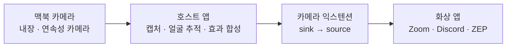

# CamZoom 프로젝트 종합 문서

2026-10-07

## 1. 한눈에 보기

맥북 카메라를 원하는 위치로 확대·자르고, 꾸미고, 캐릭터로 바꿔서 Zoom·Discord·ZEP 등 모든 화상 서비스에 그대로 내보내는 **맥 전용 무료 가상 카메라 앱**이다. 기획, 화면 구성, 기술 설계, 구현 전 검증 계획까지 마쳤고, 다음 할 일은 0단계 기술 검증(PoC)이다.

이 문서는 지금까지 정리한 모든 내용을 한곳에 모은 요약본이다. 세부 내용과 근거 출처는 아래 문서에 있고, 기술적인 내용이 서로 다르면 기술 설계서가 우선한다.

| 문서 | 담고 있는 내용 | 상태 |
| --- | --- | --- |
| [기획서](01-product-plan.md) | 문제 정의, 기존 서비스 분석, 연구 조사, 기능·로드맵, 사용자 흐름, 배포·저작권, 리스크, 테스트·출시 준비, 3차 검증 기록 | 완료 (14장) |
| [화면 구성](../design/screens/README.md) | 메뉴바 팝오버, 메인 창, 설정 창, 설치 안내 창의 라이트·다크 와이어프레임 | 1차 완료 |
| [기술 설계서](02-technical-design.md) | 아키텍처, 기술 스택·버전, 모듈 구조, 프레임 파이프라인, 앱↔익스텐션 통신, 효과·캐릭터 엔진, 저장, 동시성, CI, 테스트, ADR, 설계 검토 16건 | 완료 (14장) |
| [기술 검증 계획](03-verification-plan.md) | 게이트 4개, 검증 항목 25개, 통과 기준·대안, 기기 매트릭스, 측정법, 확정 체크리스트, 일정 | 완료 |
| [GitHub 저장소 caminout](https://github.com/kjungit/caminout) | 이 문서들, 설계서 구조의 패키지 5개, 호스트 앱, 카메라 익스텐션, CI, 검증 도구 | 0단계 코드 완료 |

**현재 단계**: 기획·설계 완료 → **0단계 기술 검증 진행 중** (코드·도구 준비 완료, 실기 검증 대기) → 1단계 MVP 개발

**이름**: CamZoom은 가칭이다. 실제 화상회의 서비스 Zoom과 혼동되고 상표 문제가 생길 수 있어 정식 이름은 따로 정한다(10장).

## 2. 제품 기획 요약

Zoom·Discord 같은 화상 서비스는 카메라 영상을 그대로 보여주기만 하고, 확대 위치·자르기 비율·꾸미기를 사용자가 정할 수 없다. 이 앱은 맥에 가상 카메라를 하나 추가해, 사용자가 만든 화면을 어떤 화상 서비스에서든 그대로 쓰게 한다.

**해결하는 문제**

- 화상 서비스에서 카메라 화면의 확대 위치, 비율(정사각형 등), 꾸미기를 조절할 수 없다.
- 무료 필터 카메라였던 Snap Camera가 2023년 1월 25일 종료된 뒤, 맥에서 "무료·간단·재미"를 갖춘 대안이 비어 있다.
- 기존 대안은 OBS처럼 방송용이라 복잡하거나, Camo처럼 핵심 기능이 유료이거나, Animaze처럼 맥을 지원하지 않는다.

**목표 사용자 (1차 가정)**

- Discord·ZEP에서 친구들과 영상 통화하며 장난치고 싶은 10~20대 맥 사용자
- 온라인 수업·회의에서 카메라 구도를 원하는 대로 고정하고 싶은 학생·직장인
- 얼굴은 보이기 싫지만 표정은 전달하고 싶은 사용자

**핵심 가치 3가지**

1. **조절**: 원하는 위치를 원하는 배율로 확대하고, 정사각형 등으로 잘라서 고정한다.
2. **꾸미기·웃기기**: 필터, 프레임, 얼굴을 따라다니는 스티커, 얼굴 왜곡, 리액션 효과.
3. **캐릭터**: 내 얼굴과 표정을 따라 움직이는 2D·3D 캐릭터로 영상을 대체한다.

**제품 원칙**

- 무료, 광고 없음, 회원가입 없음
- 영상은 맥 안에서만 처리하고 외부로 보내지 않음
- 한 번 설정하면 유지되고, 화상 앱에서는 카메라를 한 번만 고르면 됨
- 맥 전용, 웹사이트 직접 배포

**기존 서비스 대비 위치**

| 서비스 | 맥 | 가격 | 한계 |
| --- | --- | --- | --- |
| macOS 기본 비디오 효과 | 기본 내장 | 무료 | 수동 확대·이동은 광각 카메라에서만, 정사각형·스티커 없음 |
| OBS Studio | 지원 | 무료 | 방송용이라 복잡, 얼굴 효과 없음 |
| Camo | 지원 | 무료 + 유료 | 무료는 720p 이하, 고급 기능 유료 |
| VTube Studio | 지원 | 무료 + 유료 | 방송용, 캐릭터 파일 직접 준비, 무료는 워터마크 |
| Animaze | 미지원 | 무료 + 구독 | 맥에서 쓰려면 가상 머신 필요 |
| Snap Camera | 종료 | — | 2023년 서비스 종료 |

차별화 방향은 "방송 도구가 아닌 화상 통화용 앱"이다. 설치 후 3분 안에 Zoom에 적용되는 단순함, 워터마크 없는 무료, 맥 네이티브 성능을 내세운다. 시장 분석의 출처는 기획서 2장에 있다.

## 3. 기능과 단계별 로드맵

"조절 + 가상 카메라"만으로 출시 가능한 MVP를 먼저 만들고, 꾸미기 → 웃긴 효과 → 2D 캐릭터 → 3D 캐릭터 순으로 확장한다. 각 단계는 앞 단계의 영상 처리 위에 효과 레이어를 하나씩 쌓는 구조라 재작업이 적다. Swift 경험이 있는 1인 개발 기준으로 MVP까지 약 1~1.5개월, 전체 약 5~6개월이다.

```mermaid
gantt
    title MVP까지 약 6주, 3D 캐릭터까지 약 25주 (단계별 기간은 상한값)
    dateFormat  X
    axisFormat  %s주
    section 개발 단계
    0 · 기술 검증 (1~2주)      :s0, 0, 2
    게이트 A·B                  :milestone, m1, 2, 0
    1 · MVP 조절 (3~4주)       :crit, s1, 2, 6
    2 · 꾸미기 (3주)            :s2, 6, 9
    게이트 C                    :milestone, m2, 9, 0
    3 · 웃긴 효과 (4주)         :s3, 9, 13
    4 · 2D 캐릭터 (4~6주)       :s4, 13, 19
    게이트 D                    :milestone, m3, 19, 0
    5 · 3D 캐릭터 (6주+)        :s5, 19, 25
```

| 단계 | 기능 | 완료 기준 |
| --- | --- | --- |
| 0. 기술 검증 | 가상 카메라 왕복, 화상 앱 호환성, 성능 측정 | 게이트 A·B 통과 (8장) |
| 1. MVP | 위치 지정 확대·축소(1~5배), 자르기 비율(원본·정사각형·4:3·16:9), 좌우 반전·회전, 설정 자동 저장, 가상 카메라 | Zoom·Discord·ZEP에서 확대·자른 화면이 나감, 서명·공증된 DMG 배포 |
| 2. 꾸미기 | 색 보정, 필터, 프레임, 텍스트·이름표, 고정 스티커, 배경 흐림·교체 | 기능 동작, 30fps 유지 |
| 3. 웃긴 효과 | 얼굴 따라다니는 스티커, 얼굴 왜곡, 드라마틱 줌, 리액션, 화면 얼리기, 대칭·분신, 얼굴 가면형 캐릭터 | 얼굴 추적 효과가 30fps로 동작 |
| 4. 2D 캐릭터 + 편의 | 기본 캐릭터 3종, 화면 전체 캐릭터 모드, 프리셋, 전역 단축키 | 눈 깜빡임·입 벌림·고개 기울기 반영 |
| 5. 3D 캐릭터 | VRM 캐릭터 불러오기, 52개 표정 반영 | 게이트 D 통과 후 진행 |

가상 카메라는 1280×720과 1920×1080을 기본으로 제공하고, 정사각형은 16:9 안에 가운데 배치하는 방식을 기본으로 한다. 정사각형 그대로(1080×1080) 내보내기는 선택 옵션이다. 화상 앱마다 정사각형 형식을 자르거나 거부할 수 있기 때문이다.

## 4. 화면 구성

화면은 4개이고, 모두 라이트·다크 모드를 지원한다. 메인 창은 가운데에 "상대방에게 보이는 화면" 미리보기를 항상 크게 두고, 오른쪽 패널만 탭에 따라 바꾸는 구조로 정했다. 효과나 캐릭터를 고르면 미리보기에 바로 반영된다. 동작하는 시안은 화면 구성 캔버스(https://claude.ai/artifact/Dz6oxhHYSABb2ioHr3mbAc)에 있고, 원본 파일은 `design/screens/`에 있다.

| 화면 | 역할 | 주요 요소 |
| --- | --- | --- |
| 메뉴바 팝오버 | 통화 중 빠른 조작 | 작은 미리보기, 전체 켜기·끄기, 확대 슬라이더, 프리셋, 효과 스위치, 메인 창 열기 |
| 메인 창 | 세부 설정 | 왼쪽 탭(조절·꾸미기·효과·캐릭터), 가운데 미리보기, 오른쪽 설정 패널, "효과 끄고 비교" 스위치 |
| 설정 창 | 앱 설정 | 입력 카메라, 출력 해상도, 단축키, 화면 모드(시스템·라이트·다크), 로그인 시 자동 실행, 메뉴바만 표시 |
| 설치 안내 창 | 첫 실행 | 카메라 권한 → 가상 카메라 설치 → 시스템 설정에서 허용 → 확대·비율 설정 → 완료, 5단계 |

**메인 창 탭별 오른쪽 패널**

- **조절**: 원본 썸네일과 확대 영역(노란 상자), 확대 1~4배 슬라이더, 비율(원본·정사각형·4:3·16:9), 초기화
- **꾸미기**: 필터 6종(원본·흑백·레트로·만화풍·필름·세피아), 프레임(없음·폴라로이드·TV·액자), 배경 흐림
- **효과**: 얼굴 스티커(고깔모자·선글라스·콧수염), 얼굴 왜곡, 리액션, 화면 얼리기, 드라마틱 줌
- **캐릭터**: 기본 캐릭터 3종(말랑이·냥이·곰돌), 표정 테스트, 무표정 기준 다시 잡기, VRM 불러오기

**UX 원칙**

- 원본과 결과를 함께 보여줘서 "상대방에게 어떻게 보이는지"를 항상 확인할 수 있게 한다.
- 효과는 스위치 하나로 즉시 원래 화면으로 돌아갈 수 있어야 한다.
- 앱이 꺼져 있으면 가상 카메라는 검은 화면 대신 "앱을 실행해 주세요" 안내를 내보낸다.
- 화상 앱의 내 화면은 좌우가 반전돼 보일 수 있지만 상대방에게는 정상으로 보인다는 안내를 미리보기 아래에 둔다.
- 설치 완료까지 3분 이내. 가장 막히기 쉬운 시스템 확장 승인 단계에는 "시스템 설정 열기" 버튼을 둔다.

**색**: 강조색은 코랄 계열이고, 글자 대비가 부족하지 않도록 라이트 모드 강조색은 진하게(#C93A16), 다크 모드는 밝게(#FF8A66) 조정했다. 정해진 디자인 시스템은 아직 없다.

## 5. 기술 아키텍처 요약

전부 Swift와 애플 기본 프레임워크로 만든다. Electron은 가상 카메라(시스템 확장)를 만들 수 없고 실시간 영상 처리에도 맞지 않아 제외했다. 호스트 앱이 모든 영상 처리를 맡고, 카메라 익스텐션은 완성된 프레임을 화상 앱에 전달만 한다. 세부 내용은 기술 설계서 2~12장에 있다.

**핵심 구조**

- **프로세스 2개**: 호스트 앱(카메라 캡처, 얼굴 추적, 효과 합성, 미리보기, 설정)과 카메라 익스텐션(프레임 전달, 앱이 꺼졌을 때 안내 화면). 앱은 화상 앱이 가상 카메라를 열 때만 실제 카메라를 켠다.
- **전달 방식**: 앱이 익스텐션의 sink 스트림 큐에 프레임을 넣고, 익스텐션이 source 스트림으로 내보낸다. 애플 개발자 포럼에서 안내된 방식이고 XPC는 쓰지 않는다.
- **프레임 파이프라인**: 캡처 → 합성 → 출력을 33ms(30fps) 안에 처리한다. 얼굴 추적은 경로 밖에서 비동기로 돌고, 합성은 최신 추적 결과를 쓴다. 목표 지연은 100ms 이하다.
- **효과는 레이어**: 자르기 → 배경 → 얼굴 왜곡 → 캐릭터 → 색 필터 → 얼굴 스티커 → 오버레이 → 프레임 → 출력 맞춤 순서로 쌓는다.
- **모듈**: 타깃 2개(앱, 익스텐션), 기능 패키지 5개(CaptureKit, FaceTracking, EffectsKit, CharacterKit, CameraBridge), 기반 패키지 2개(CamZoomCore, CamZoomShared). 익스텐션은 CamZoomShared만 의존해 효과를 고쳐도 재설치가 필요 없다.
- **상태**: 화면 상태를 복사한 불변 스냅샷을 파이프라인이 읽는다. 설정·프리셋은 버전 번호가 붙은 JSON 파일로 저장한다.
- **전력**: 쓰는 앱이 없으면 카메라를 끄고, 발열·저전력 모드에서는 품질을 4단계로 자동으로 낮춘다.

**기술 스택**

| 영역 | 선택 | 단계 |
| --- | --- | --- |
| 언어·UI | Swift 6, SwiftUI, 메뉴바 앱 | 1 |
| 카메라 입력 | AVFoundation | 1 |
| 영상 처리 | Core Image + Metal | 1 |
| 가상 카메라 | Core Media I/O 카메라 익스텐션 (macOS 12.3+) | 1 |
| 업데이트 | Sparkle 2 | 1 |
| 사람 분리 | Vision 사람 분리 | 2 |
| 얼굴 추적 | Vision 얼굴 랜드마크 (76점) | 3 |
| 3D 표정 추적 | MediaPipe Face Landmarker (52개 표정 계수) | 5 |
| 3D 렌더링 | RealityKit RealityRenderer + VRMKit (macOS 15+) | 5 |

**최소 사양**: macOS 14 이상, 3D 캐릭터만 macOS 15 이상. Apple Silicon 권장, Intel 지원은 미정. 외부 라이브러리는 Sparkle, VRMKit, MediaPipe 세 개로 제한한다.

**쓰지 않기로 한 것**: SceneKit(지원 중단 예고), Live2D(아바타 앱은 별도 계약 필요), DAL 플러그인(구 방식), Electron.

## 6. 캐릭터·인물 대체 방식

캐릭터로 사람을 대체하는 기술은 VTube Studio 같은 출시 제품에서 이미 검증됐다. 맥 웹캠만으로 표정을 읽어 캐릭터를 움직이는 것도 가능하다. 반면 "사진 속 인물을 내 표정대로 움직이기"는 연구로는 증명됐지만 맥에서 실시간으로 돌아간다는 근거가 없어 보류한다.

| 방식 | 설명 | 검증 수준 | 결정 |
| --- | --- | --- | --- |
| A. 화면 전체 대체 | 배경 이미지 위에 캐릭터만 출력. 실제 영상은 표정을 읽는 데만 사용 (버튜버 방식) | 출시 제품에서 검증 | 4단계 2D 캐릭터의 기본 모드 |
| B. 사람만 대체 | 사람 분리 마스크로 사람을 지우고, 미리 찍은 빈 배경 사진으로 채운 뒤 캐릭터를 그림 | 구성 기술은 각각 검증, 조합은 직접 검증 필요 | 게이트 C(C5·C6) 통과 후 포함 |
| C. 얼굴만 덮기 | 얼굴 위치·기울기에 맞춰 캐릭터 머리만 씌움. 몸은 실제 영상 | 얼굴 스티커와 같은 기술 | 3단계 "얼굴 가면형 캐릭터"로 포함 |
| D. 정지 사진 띄우기 | 카메라 대신 사진 한 장을 출력 ("자리 비움" 화면) | 단순 이미지 출력 | 언제든 추가 가능 |
| E. 사진 움직이기 | 사진 속 인물이 내 표정을 따라 움직임 | 연구 수준, 맥 실시간 근거 없음 | 보류 |

**A~C 구현 방법**

1. Vision으로 매 프레임 고개 방향, 눈 뜸, 입 벌림, 얼굴 위치·크기를 읽어 FaceFrame으로 만든다. 값이 떨리지 않게 다듬고, 무표정 상태를 기준으로 보정한다.
2. 2D 캐릭터는 부품 이미지(얼굴, 눈 뜬/감은, 입 3단계)를 FaceFrame 값에 따라 바꾸고 기울인다. 형식은 부품 PNG + 설정 JSON 폴더다. 3D는 VRM 모델의 표정 값을 움직여 RealityRenderer로 그린다.
3. 합성은 효과 레이어 4번(캐릭터) 자리에서 한다. A는 배경 위에 캐릭터만, B는 사람 분리 마스크로 지운 자리를 빈 배경 사진(또는 흐림)으로 채우고 캐릭터를 그리며, C는 얼굴 상자에 맞춰 머리만 덮는다.

B 방식은 "자리를 비켜 주세요 → 배경 촬영" 단계가 필요하고, 조명이 바뀌거나 노트북을 움직이면 경계가 어색해진다.

**E를 보류하는 이유**

- **성능**: 대표 기술인 [LivePortrait](https://arxiv.org/abs/2407.03168)는 RTX 4090에서 프레임당 12.8ms로 실시간이 되지만, [공식 저장소](https://github.com/KlingTeam/LivePortrait)는 Apple Silicon에서 RTX 4090보다 약 20배 느릴 수 있다고 안내한다. Core ML 변환과 최적화가 필요한데 성공 사례를 찾지 못했다.
- **라이선스**: 코드는 MIT지만 기본 얼굴 검출에 쓰는 InsightFace 모델은 비상업 연구용이다. 이 모델을 [MediaPipe로 바꾸면 MIT·Apache 2.0 범위](https://github.com/kijai/ComfyUI-LivePortraitKJ/wiki)로 쓸 수 있다.
- **악용 위험**: 다른 사람 사진을 넣으면 그 사람인 척 화상 통화를 할 수 있다. 다른 사람 얼굴로 바꾸는 기능을 제외한 기획 원칙과 충돌한다.

E를 다시 검토한다면 게이트 D처럼 별도 검증(맥 실시간 성능, 라이선스, 악용 방지책)을 통과한 뒤에 한다.

## 7. 리스크와 설계 검토 결과

가장 큰 리스크는 기술 자체보다 **설치·삭제 경험**과 **화상 앱마다 다른 동작**이다. 설계서를 애플 문서와 개발자 포럼 사례에 대조해 빠진 부분 16건을 찾았고, 그중 출시를 막을 수 있는 6건은 구현 전 검증 항목으로 올렸다. 근거 링크는 기술 설계서 13장에 있다.

**출시를 막을 수 있는 6건**

| 번호 | 문제 | 대응 |
| --- | --- | --- |
| G1 | 확장을 처음 설치·업데이트한 직후 앱을 재시작해야 가상 카메라가 보이는 사례가 있다. 화상 앱도 재시작이 필요할 수 있다 | 설치 안내에 "앱 다시 열기" 단계와 화상 앱 재시작 안내 추가 |
| G2 | 앱을 휴지통에 넣어도 가상 카메라가 남는 버그가 macOS 15.3과 26에서 보고됐다 | 앱 메뉴에 "가상 카메라 제거" 추가, 실패 시 시스템 설정에서 직접 삭제하는 안내 |
| G3 | 화상 앱이 가상 카메라를 쓰는지 감지하는 방법이 확인되지 않았다 | 익스텐션이 연결된 클라이언트 수를 사용자 정의 속성으로 알리고 앱이 읽는 방식으로 변경 |
| G4 | 메뉴바 앱은 창이 안 보이면 App Nap에 걸려 처리가 느려질 수 있다 | 스트리밍 중에는 시스템에 "처리 중" 활동을 알려 App Nap을 막음 |
| G5 | 앱과 익스텐션 버전이 어긋나는 경우를 다루지 않았다 | 익스텐션이 버전을 알리고, 앱이 시작할 때 확인해 다르면 교체 요청 |
| G6 | Discord 맥 앱에서 가상 카메라가 보인다는 근거가 부족하다 (예전 방식 시절 미표시 사례 다수, 웹은 동작) | 검증 최우선 항목. 실패하면 Discord 웹 안내 |

**그 밖의 보완 10건 (중간·낮음)**

- 출력 색 공간(BT.709)과 밝기 범위 표시 규칙 추가 (G7)
- 가상 장치 UID는 첫 출시 후 절대 바꾸지 않기 (G8)
- 프레임 레이트는 1차로 30fps만 제공 (G9)
- 프레임 타임스탬프는 호스트 시간 기준, 단조 증가 (G10)
- 전역 단축키는 권한 없이 등록하는 시스템 핫키 방식 (G11)
- 로그인 시 자동 실행은 SMAppService (G12)
- 분석 SDK 없이 기기 안 진단(MetricKit)을 로그에 포함 (G13)
- 2시간 연속 실행 테스트를 릴리스 필수 항목으로 (G14)
- macOS 기본 비디오 효과와 겹칠 때 안내 (G15)
- 개발 중 확장 교체를 위해 빌드 번호 자동 증가 (G16)

**기획 단계에서 정리한 리스크**

| 리스크 | 대응 |
| --- | --- |
| 시스템 확장 승인 단계에서 사용자 이탈 | 그림 안내, "시스템 설정 열기" 버튼, 설치 확인 화면 |
| 화상 앱이 정사각형 형식을 자르거나 거부 | 기본 출력 16:9 + 가운데 정사각형, 앱별 호환표 공개 |
| 확대 시 화질 저하 (1080p 카메라) | 최대 배율 제한, 아이폰 연속성 카메라 입력 지원 |
| 캐릭터 모드 발열·배터리 | 추적 30fps 제한, 분석 입력 축소, 자동 품질 낮춤 |
| 캐릭터·스티커 저작권 | 직접 만든 오리지널만 탑재 |

## 8. 구현 전 검증 계획 요약

개발 단계마다 앞에 게이트를 두고, 수치로 된 통과 기준을 넘어야 다음 단계로 간다. 게이트는 4개, 검증 항목은 25개다. 실패했을 때 할 일도 항목마다 미리 정해 뒀다. 전체 항목은 [기술 검증 계획](03-verification-plan.md)에 있다.

| 게이트 | 시점 | 항목 수 | 대표 통과 기준 |
| --- | --- | --- | --- |
| A. 가상 카메라 기반 | 1단계 전 (1주차) | 7 | 앱→익스텐션 왕복 30fps 10분 누락 1% 미만, Zoom·ZEP·Discord(앱 또는 웹)에서 표시, 설치 5분 이내, 앱 메뉴 제거 후 잔존 0 |
| B. 성능·안정성 | 1단계 전 (2주차) | 8 | 지연 중앙값 100ms 이하, 합성 p95 12ms 이하, M1 CPU 10% 이하, 2시간 메모리 증가 50MB 미만, 색 오차 채널당 8 이하 |
| C. 얼굴 추적 품질 | 3단계 전 (약 8~10주차) | 6 | 추적 p95 10ms 이하, 눈·입 감지율 90% 이상, 정지 시 떨림 2px 이하, 사람만 대체(B 방식) 합성 품질 |
| D. 3D 캐릭터 | 5단계 전 (약 16~20주차) | 4 | 3D 렌더 p95 8ms 이하, MediaPipe 서명·공증 통과, VRM 3종 로딩 |

**검증 원칙**

1. 실패하면 제품이 성립하지 않는 항목(가상 카메라, 화상 앱 호환성)부터 확인한다.
2. 통과 기준 수치는 미리 정하고, 결과를 본 뒤에 바꾸지 않는다.
3. 실패 시 대안을 항목마다 미리 적어 둔다.
4. PoC 코드는 별도 브랜치에 두고 버린다. 가짜 카메라 입력과 측정 도구만 본 코드로 가져간다.
5. 설치·삭제는 개발 맥이 아닌 새 사용자 계정에서, 서명·공증된 빌드로 확인한다.

**게이트 검토 결과는 세 가지 중 하나**: 통과 / 정해 둔 대안 적용 후 진행 / 범위 조정(기능을 다음 단계로 미루거나 빼고 로드맵 수정).

**필수 테스트 환경**: M1 맥(성능 기준), macOS 14와 최신 정식 버전, 내장 1080p 카메라, Zoom 앱·Discord 앱과 웹·ZEP(Chrome·Safari), 깨끗한 새 사용자 계정.

## 9. 배포·개인정보·라이선스

웹사이트에서 직접 배포하지만 Apple Developer Program(연 $99) 가입은 필수다. 가상 카메라는 시스템 확장이라 Developer ID 서명과 애플 공증 없이는 설치되지 않는다. 사용자에게는 무료이고, 개발자 쪽 연간 비용은 약 $110~120(개발자 계정 + 도메인)이다.

**배포**

- 서명·공증·스테이플 처리한 DMG를 웹사이트와 GitHub Release로 배포하고, 업데이트는 Sparkle로 앱 안에서 알린다.
- `v*` 태그를 붙이면 CI(GitHub Actions 맥 러너)가 빌드 → 서명 → 공증 → DMG → 업데이트 피드까지 자동으로 만든다.
- 마지막 설치 확인은 개발에 쓰지 않은 맥이나 새 사용자 계정에서 한다.
- 웹사이트 구성: 30초 시연 영상, 다운로드, 설치 가이드(시스템 확장 승인 화면 포함), FAQ, 개인정보 처리 방침, 오픈소스 라이선스, 릴리스 노트.

**개인정보**

- 카메라 영상, 얼굴 랜드마크, 표정값은 맥 안에서만 처리하고 저장하지 않는다.
- 서버 전송, 분석 SDK, 광고 SDK를 넣지 않는다. 외부로 나가는 요청은 업데이트 확인뿐이다.
- 핵심 문구: "영상은 기기 밖으로 나가지 않습니다."

**저작권·라이선스**

| 항목 | 결정 |
| --- | --- |
| 유명 캐릭터(포켓몬, 디즈니 등) | 사용 금지 |
| 기본 캐릭터·스티커·프레임 | 직접 만든 오리지널만 탑재 |
| Live2D 모델 불러오기 | 도입하지 않음 (아바타 앱은 별도 계약 필요) |
| VRM 모델 불러오기 | 도입, 모델별 이용 조건을 앱에서 표시 |
| VRMKit (MIT), MediaPipe (Apache 2.0), Sparkle | 사용, 오픈소스 고지 화면 포함 |
| 다른 사람 얼굴로 바꾸기, 다른 사람 사진 움직이기 | 제외 |
| Zoom·Discord·ZEP 이름 | "호환됨" 표기에만 사용, 로고와 앱 이름에는 쓰지 않음 |

## 10. 결정 사항과 미결정 사항

제품 방향과 기술 구조는 정해졌고, 남은 것은 이름·식별자처럼 한 번 정하면 못 바꾸는 값과 검증 결과로 정할 수치들이다. 식별자(번들 ID, 가상 장치 UID)는 첫 배포 후 바꿀 수 없으므로 1단계 코딩 전에 가장 먼저 정한다.

**정해진 것**

| 영역 | 결정 | 이유 |
| --- | --- | --- |
| 플랫폼·배포 | 맥 전용, 무료, 웹사이트 직접 배포 | 가상 카메라는 맥에서만 가능, App Store 심사 불필요 |
| 개발 언어 | Swift 네이티브 (Electron 제외) | 가상 카메라는 네이티브 필수, 실시간 영상 처리 |
| 구조 | 앱이 모든 처리, 익스텐션은 전달만 | 익스텐션 재설치·디버깅 비용 최소화 |
| 전달 방식 | CMIO sink 스트림 | 애플 안내 경로, 별도 통신 불필요 |
| 영상 처리 | Core Image + Metal | 레이어 조합이 쉽고 GPU 처리 |
| 얼굴 추적 | Vision 우선, 3D만 MediaPipe | 기본 내장이라 연동 위험 없음 |
| 캐릭터 형식 | 2D는 자체 부품 형식, 3D는 VRM | Live2D 계약 회피, 공개 규격 사용 |
| 캐릭터 모드 | 화면 전체 대체(A)가 기본, 얼굴 가면형(C)은 3단계 | 출시 제품에서 검증된 방식 |
| 설정 저장 | 버전 번호가 붙은 JSON 파일 | 프리셋 공유와 형식 변경에 유리 |
| 출력 형식 | 16:9 기본, 정사각형은 가운데 배치 | 화상 앱별 정사각형 처리 차이 |
| 최소 사양 | macOS 14 (3D는 15) | RealityRenderer·VRMKit 요구 사항 |
| 화면 | 미리보기 중심 메인 창, 라이트·다크 모드 | 효과를 보면서 설정 |
| 제외 | 딥페이크류, 사진 움직이기(보류), Live2D, SceneKit | 악용 위험, 맥 성능 근거 없음, 라이선스, 지원 중단 |

**아직 정하지 않은 것**

- [ ] 앱 이름과 가상 카메라 표시 이름 ("Zoom"이 들어간 이름은 피함)
- [ ] 주 사용 대상 우선순위: 친구들과 장난용 / 온라인 수업용 / 회의용
- [ ] Intel 맥 지원 여부
- [ ] 번들 ID와 가상 장치·스트림 UID (1단계 코딩 전)
- [ ] 광고할 출력 형식 목록, 색 공간, 버퍼 풀 크기 (게이트 A·B 결과)
- [ ] 사용 중 감지 방식, 익스텐션 버전 확인 방식 (게이트 A 결과)
- [ ] 설치 안내에 앱 재시작 단계가 필요한지 (게이트 A 결과)
- [ ] 사람만 대체(B 방식) 포함 여부 (게이트 C 결과)
- [ ] 3D 캐릭터(5단계) 진행 여부 (게이트 D 결과)
- [ ] 디자인 시스템과 기본 캐릭터 3종의 최종 그림체

## 11. 저장소 현황과 다음 단계

저장소는 기술 설계서 4장의 모듈 구조로 다시 짜였다. 1단계 MVP 범위(위치 지정 확대, 비율, 반전·회전, 설정 자동 저장, 가상 카메라)의 코드와 게이트 A·B 측정 도구가 들어 있고, 남은 일은 서명 빌드로 실제 화상 앱에서 게이트 A·B를 확인하는 것이다.

**현재 들어 있는 것**

| 경로 | 내용 |
| --- | --- |
| `docs/` | 이 종합 문서, 기획서, 기술 설계서, 기술 검증 계획, [게이트 A·B 진행 절차](verification/gate-a-b-checklist.md), [배포 준비](release.md) |
| `design/screens/` | 화면 구성 캔버스 원본 파일 (라이트·다크 8개 화면) |
| `Packages/` | CamZoomCore, CamZoomShared, EffectsKit, CaptureKit, CameraBridge + 각 단위 테스트 |
| `App/CamZoom/` | 메뉴바 팝오버, 메인 창(조절 탭), 설정 창, 설치 안내 5단계, 프레임 파이프라인, 확장 설치·제거, 자동 품질 낮춤, MetricKit 진단·진단 정보 내보내기 |
| `Extension/CamZoomExtension/` | CMIO 카메라 익스텐션 (sink → source 전달, 안내 화면, 사용자 정의 속성) |
| `project.yml`, `CamZoom.xcodeproj` | XcodeGen 프로젝트 정의와 생성된 프로젝트 |
| `scripts/`, `tools/verification/` | 개발 설치 스크립트, 밀리초 시계·색 막대·결과 기록 양식 |
| `.github/workflows/` | CI(패키지 테스트, 서명 없는 빌드), 릴리스(서명·공증·DMG) |

**설계서에 맞추기 위해 고친 것**

- [x] `FrameProcessor`를 없애고 EffectsKit의 합성기(Compositor)와 레이어로 대체했다 (CamZoomCore는 계산·모델만)
- [x] `CropState` 저장을 UserDefaults에서 버전 번호가 붙은 JSON 파일(SettingsStore)로 바꿨다
- [x] 익스텐션은 CamZoomShared만 쓴다. CamZoomShared 패키지를 추가했다
- [x] `docs/`에 기술 설계서, 기술 검증 계획, 이 종합 문서를 추가하고 `docs/verification/` 폴더를 만든다

**설계와 다르게 둔 것**

- Sparkle 자동 업데이트는 업데이트 피드를 올릴 웹사이트가 생길 때 넣는다 ([배포 준비](release.md)).
- 번들 ID는 `com.kjungit.caminout`, 익스텐션 `com.kjungit.caminout.extension`, 장치 UID는 `CamZoomShared/CameraIdentity.swift`에 임시로 정했다. 첫 배포 전에 앱 이름과 함께 확정한다.

**다음 단계**

1. 10장의 미결정 사항 중 앱 이름, 주 사용 대상, Intel 지원 여부를 정한다.
2. Xcode에 Apple Developer 계정으로 로그인하고 `scripts/install-dev.sh`로 서명 빌드를 설치한다.
3. 검증 준비: 테스트용 새 사용자 계정, 테스트 영상. 가짜 카메라 입력과 측정 도구는 저장소에 있다.
4. [게이트 A·B 진행 절차](verification/gate-a-b-checklist.md)대로 게이트 A(1주) → 게이트 B(1주) → 게이트 검토.
5. 기술 확정 체크리스트를 채우고 ADR을 갱신한 뒤 1단계 MVP 개발을 시작한다.

실제 빌드와 카메라·가상 카메라 테스트는 맥에서 Xcode로 해야 한다. 코드 작업을 맡길 때는 맥에서 직접 빌드·실행까지 할 수 있는 Claude Code가 적합하다.
