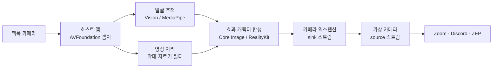
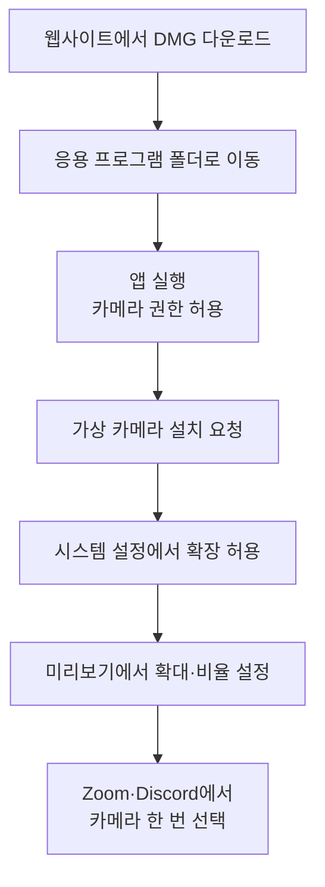

# 맥 전용 카메라 꾸미기·캐릭터 가상 카메라 앱 기획서

Sep 26, 2026

## 1. 제품 개요

맥북 카메라를 조절하고, 꾸미고, 캐릭터로 바꿔서 Zoom·Discord·ZEP 등 모든 화상 서비스에 그대로 내보내는 맥 전용 무료 가상 카메라 앱이다. 가칭은 CamZoom으로 두고, 이름은 추후 확정한다. (참고: "Zoom"이 들어간 이름은 실제 화상회의 서비스와 혼동될 수 있어 최종 이름에서는 피한다.)

**해결하려는 문제**

- Zoom, Discord 같은 화상 서비스는 카메라 영상을 그대로 보여주기만 하고, 확대 위치·자르기 비율·꾸미기를 사용자가 제어할 수 없다.
- 데스크톱용 무료 필터 카메라였던 Snap Camera가 종료된 뒤, 맥에서 "무료·간단·재미"를 모두 갖춘 대안이 비어 있다.
- 기존 대안은 OBS처럼 방송용이라 복잡하거나, Camo처럼 핵심 기능이 유료다.

**목표 사용자 (1차 가정)**

- 친구들과 Discord·ZEP에서 영상 통화를 하며 장난치고 싶은 10~20대 맥 사용자
- 온라인 수업·회의에서 카메라 구도를 원하는 대로 고정하고 싶은 학생·직장인
- 얼굴을 그대로 보이기 싫지만 표정은 전달하고 싶은 사용자 (캐릭터 모드)

**핵심 가치 3가지**

1. **조절**: 원하는 위치를 원하는 배율로 확대하고, 정사각형 등으로 잘라서 고정한다.
2. **꾸미기·웃기기**: 필터, 프레임, 얼굴을 따라다니는 스티커, 얼굴 왜곡, 리액션 효과를 쓴다.
3. **캐릭터**: 내 얼굴과 표정을 따라 움직이는 2D·3D 캐릭터로 영상을 대체한다.

**제품 원칙**

- 무료로 제공하고, 광고와 회원가입을 넣지 않는다.
- 모든 영상 처리는 맥 안에서만 한다. 영상을 외부 서버로 보내지 않는다.
- 설정은 한 번 해 두면 유지되고, 화상 앱에서는 카메라를 한 번만 선택하면 된다.
- 맥 전용으로 만들고, 웹사이트에서 직접 배포한다.

## 2. 기존 서비스 분석

조절·꾸미기·캐릭터를 모두 무료로, 맥에서 가상 카메라 하나로 제공하는 앱은 찾지 못했다. 각 기능은 여러 앱에 흩어져 있고, 대부분 유료 해제, 방송용 복잡도, 윈도우 전용 중 하나의 제약이 있다.

| 서비스 | 맥 지원 | 가격 | 조절(확대·자르기) | 꾸미기·효과 | 캐릭터(표정 추적) | 한계 |
| --- | --- | --- | --- | --- | --- | --- |
| [macOS 기본 비디오 효과](https://support.apple.com/guide/mac-help/use-the-camera-mchlp2980/15.0/mac/15.0) | 기본 내장 | 무료 | 광각 카메라(12MP 센터 스테이지 카메라 맥, 아이폰 연속성 카메라)에서만, 센터 스테이지를 끈 상태로 수동 확대·이동 | 인물 모드, 스튜디오 조명, 배경, 리액션 | 없음 | 구형 1080p 카메라 맥은 수동 프레이밍 불가, 정사각형 자르기·스티커 없음 |
| [OBS Studio](https://www.macworld.com/article/1371950/crop-iphone-webcam-on-mac.html) | 지원 | 무료 | 크롭으로 가능 | 필터 일부, 얼굴 추적 효과 없음 | 없음 | 방송용이라 조작이 복잡함 |
| [Camo Studio](https://reincubate.com/camo/pricing) | 지원 | 무료 + Pro | 가능 | 배경, 필터, Snap 기반 AR 모드 | 없음 | 무료는 720p 이하, 고급 기능은 유료 |
| [VTube Studio](https://store.steampowered.com/app/1325860/VTube_Studio/) | 지원 (Steam) | 무료, 워터마크 제거 유료 | 없음 | 캐릭터용 효과 | Live2D 2D 캐릭터, 웹캠 추적 | 방송용, 캐릭터 파일을 직접 구해야 함, 무료는 워터마크 |
| [Animaze](https://www.animaze.us/faq/animazedesktop/macos) | 미지원 (가상 머신 필요) | 무료 + 구독 | 없음 | 소품, 배경 | 2D·3D 캐릭터 | 맥 네이티브 미지원 |
| [Snap Camera](https://www.techloy.com/snap-to-shut-down-its-camera-application-for-mac-and-pcs/) | 종료 | 무료였음 | 없음 | AR 필터 다수 | 일부 렌즈 | 2023-01-25 서비스 종료 |
| [CamDeck](https://camdeckapp.com/) | 지원 | 무료 | 확인 안 됨 | 효과 20종, 오버레이, 하단 자막 바 | 없음 | 방송·오버레이 중심 |

**시장에서 확인한 사실**

- Snap Camera는 2018년 출시돼 Zoom 등에서 얼굴 필터를 쓰게 해 주던 무료 앱이었고, 2023년 1월 25일 맥·PC 모두 종료됐다. 이후 "대체 앱"을 찾는 수요가 계속 검색되고 있다.
- VTube Studio는 오픈소스 추적기 OpenSeeFace로 웹캠 얼굴 추적을 지원하고, 가상 웹캠으로 Discord·Zoom에 캐릭터를 내보낼 수 있다. 무료지만 웹캠 추적 중에는 워터마크가 붙는다.
- Animaze는 맥 버전이 없어서, 공식 FAQ가 가상 머신으로 윈도우를 돌리라고 안내한다.
- 애플은 광각 카메라(12MP 센터 스테이지 카메라가 달린 맥, 또는 아이폰 연속성 카메라)를 쓸 때만, 센터 스테이지를 끈 상태에서 수동 확대·이동 프레이밍을 제공한다.

**시장 공백 (우리 앱의 자리)**

1. 모든 맥에서 동작하는 무료 확대·위치 지정·정사각형 자르기
2. Snap Camera가 빠진 뒤 비어 있는 "웃긴 얼굴 효과" 무료 가상 카메라
3. 방송용 설정 없이 바로 쓰는 맥 네이티브 캐릭터 모드

**차별화 방향**: 방송 도구가 아니라 화상 통화용 앱. 설치 후 3분 안에 Zoom에 적용되는 단순함, 워터마크 없는 무료, 맥 네이티브 성능을 내세운다.

## 3. 연구·기술 조사

일반 웹캠 한 대로 얼굴 위치와 약 50가지 표정을 실시간 추적해 캐릭터를 움직이는 기술은 이미 공개 연구와 무료 도구로 검증돼 있다. 맥북에는 아이폰의 TrueDepth 같은 깊이 카메라가 없으므로, RGB 영상만 쓰는 방식을 전제로 한다.

### 3.1 핵심 연구

| 연구 (연도) | 핵심 내용 | 우리 앱에 주는 의미 |
| --- | --- | --- |
| [BlazeFace](https://arxiv.org/abs/1907.05047) (Google, 2019) | 모바일 GPU용 경량 얼굴 검출기. 플래그십 기기에서 200~1000+ FPS | 얼굴 찾기 단계는 사실상 비용이 거의 들지 않는다 |
| Attention Mesh (Google, 2020, arXiv:2006.10962) | 실시간 고정밀 얼굴 메시 예측 | MediaPipe 얼굴 랜드마크의 기반 기술 |
| [Blendshapes GHUM](https://arxiv.org/pdf/2309.05782) (Google, 2023) | RGB 이미지 한 장에서 52개 블렌드셰이프 계수를 휴대폰 기준 30+ FPS로 예측. 아이폰 ARKit과 같은 52개 체계 사용 | 맥북 웹캠만으로도 캐릭터 표정 추적이 가능하다는 근거 |

**Blendshapes GHUM 세부 수치**

- 478개 얼굴 랜드마크 모델은 Pixel 6에서 8ms, 표정 계수 모델은 1.2ms에 동작한다.
- 520개 테스트 영상 중 96%에서 표정이 제대로 잡혔다고 평가됐다.
- 랜드마크 오차(MNE)는 2.71%로, 사람 주석자 간 오차 2.56%와 비슷하다.
- 블렌드셰이프는 캐릭터가 사람 얼굴과 닮지 않아도 적용할 수 있다. 동물·사물 캐릭터도 가능하다는 뜻이다.

### 3.2 쓸 수 있는 도구 비교

| 도구 | 제공 정보 | 맥 사용성 | 비용 |
| --- | --- | --- | --- |
| [Apple Vision](https://developer.apple.com/documentation/vision/vndetectfacelandmarksrequest.md) 얼굴 랜드마크 | 2D 랜드마크 65개 또는 76개(리비전 3), 눈·눈썹·코·입술·동공·얼굴 윤곽, 얼굴 기울기 | 맥 기본 내장, Swift에서 바로 사용 | 무료 |
| [MediaPipe Face Landmarker](https://developers.google.com/edge/mediapipe/solutions/vision/face_landmarker) | 3D 랜드마크 478개, 표정 계수 52개, 얼굴 변환 행렬 | 공식 Swift SDK는 iOS용. 맥은 C 라이브러리 연동 필요 ([MacGaze](https://github.com/AACTools/MacGaze) 사례) | 무료 오픈소스 |
| OpenSeeFace | 웹캠 얼굴 추적 | VTube Studio·VSeeFace가 사용. 파이썬 기반이라 앱 내장이 번거로움 | 무료 오픈소스 |

**선택 근거**

- 스티커·2D 캐릭터는 Apple Vision으로 충분하다. 눈 뜸 정도는 눈 윤곽 높이, 입 벌림은 입술 간격, 고개 방향은 얼굴 기울기로 계산한다.
- 3D 캐릭터의 섬세한 표정(미소, 눈썹, 볼 부풀리기 등)은 MediaPipe의 52개 계수가 필요하다. 맥 연동 작업이 있으므로 후반 단계로 둔다.

### 3.3 기존 제품에서 얻은 설계 교훈

- VTube Studio는 추적값을 60 FPS로 보간하므로, 추적을 30 FPS보다 높게 돌려도 움직임 품질 이득이 적다고 안내한다. 우리도 추적 30 FPS + 렌더링 보간을 기본값으로 한다.
- VTube Studio는 웹캠 추적에 1280×720, 최소 10 FPS를 권장한다. 추적 입력 해상도를 낮게 유지해 성능을 아낀다.
- VTube Studio는 무표정 상태를 기준으로 잡는 보정(캘리브레이션) 버튼을 둔다. 사람마다 얼굴 기본값이 달라서 필요하다.

## 4. 기술 스택과 아키텍처

전부 애플 기본 프레임워크와 무료 오픈소스로 구성한다. 유료 비용은 Apple Developer Program 연 $99 하나다. 호스트 앱이 영상을 모두 처리하고, 가상 카메라 익스텐션은 완성된 프레임을 받아 화상 앱에 내보내기만 하는 구조다.

### 4.1 데이터 흐름

애플이 WWDC22에서 소개한 "크리에이티브 카메라" 구조와 같다. 호스트 앱이 sink 스트림에 프레임을 넣으면, 익스텐션이 그것을 일반 카메라처럼 다른 앱에 제공한다.

### 4.2 기술 스택

| 영역 | 선택 | 이유 |
| --- | --- | --- |
| 언어·UI | Swift, SwiftUI, 메뉴바 앱 | 맥 네이티브, 가벼움 |
| 카메라 입력 | AVFoundation | 맥 표준 카메라 API |
| 영상 처리 | Core Image + Metal | GPU 처리로 확대·자르기·필터·왜곡을 실시간 처리 |
| 얼굴 추적 (1차) | Apple Vision 얼굴 랜드마크 | 기본 내장, 스티커·2D 캐릭터에 충분 |
| 얼굴 추적 (2차) | MediaPipe Face Landmarker | 3D 캐릭터용 52개 표정 계수 |
| 사람 분리 (배경) | Apple Vision 사람 분리 요청 | 기본 내장, 배경 흐림·교체 |
| 2D 캐릭터 렌더링 | 자체 부품형 2D 인형 + Core Image 합성 | Live2D 라이선스 제약 회피 (7장 참고) |
| 3D 캐릭터 렌더링 | RealityKit + [VRMKit](https://github.com/tattn/VRMKit/wiki) | SceneKit은 WWDC25에서 지원 중단 예고, VRMKit은 MIT 라이선스이고 RealityKit 렌더링은 macOS 15 이상 |
| 가상 카메라 | [Core Media I/O 카메라 익스텐션](https://developer.apple.com/documentation/coremediaio/creating-a-camera-extension-with-core-media-i-o.md) | macOS 12.3 이상의 공식 방식. 구 방식(DAL 플러그인)은 지원 종료 |
| 설정 저장 | JSON 프리셋 파일 | 프리셋 공유·백업이 쉬움 |
| 배포·업데이트 | Developer ID 서명 + 공증, DMG, Sparkle | 웹사이트 직접 배포 표준 방식 |

### 4.3 최소 사양 (1차 결정안)

- **macOS 14 이상**: 기본 기능(조절·꾸미기·스티커·2D 캐릭터)
- **macOS 15 이상**: 3D 캐릭터 모드 (VRMKit의 RealityKit 렌더링 요구 사항)
- **Apple Silicon 권장**: Intel 맥은 캐릭터 모드 성능 확인 후 지원 여부 결정

### 4.4 성능 목표

| 항목 | 목표 |
| --- | --- |
| 출력 프레임 | 30 FPS 유지 |
| 카메라 입력 → 화상 앱 지연 | 100ms 이하 |
| 얼굴 추적 | 30 FPS, 입력 1280×720 이하로 축소해 분석 |
| CPU 사용률 (M1 기준) | 조절 모드 10% 이하, 캐릭터 모드 30% 이하 |

### 4.5 PoC(사전 검증)로 확인할 기술 질문

- [ ] RealityKit 3D 장면을 화면 없이(오프스크린) 렌더링해 매 프레임 픽셀 버퍼로 받아올 수 있는가
- [ ] MediaPipe C 라이브러리를 서명·공증된 맥 앱에 넣었을 때 문제없이 동작하는가
- [ ] 호스트 앱이 꺼져 있을 때 익스텐션이 "앱을 실행해 주세요" 안내 화면을 내보낼 수 있는가
- [ ] Zoom, Discord, ZEP(Chrome·Safari)에서 가상 카메라가 모두 인식되는가

## 5. 기능 명세와 단계별 로드맵

MVP는 "조절 + 가상 카메라"만으로 출시 가능한 상태를 먼저 만들고, 꾸미기 → 웃긴 효과 → 캐릭터 순으로 확장한다. 각 단계는 앞 단계의 영상 처리 파이프라인 위에 효과를 한 층씩 추가하는 구조라 재작업이 적다.

### 5.1 기능 목록

| 기능 | 설명 | 필요 기술 | 단계 |
| --- | --- | --- | --- |
| 위치 지정 확대·축소 | 클릭·드래그로 확대 위치 지정, 슬라이더·핀치로 1~5배 | Core Image | 1 |
| 자르기 비율 | 원본, 정사각형, 4:3, 16:9 | Core Image | 1 |
| 정사각형 출력 방식 | 기본값은 16:9 안에 정사각형을 가운데 배치하고 양옆 채움, 선택 시 정사각형 그대로 내보내기 | Core Image | 1 |
| 좌우 반전·회전 | 90도 단위 회전 | Core Image | 1 |
| 설정 고정·자동 저장 | 재실행해도 유지 | JSON 저장 | 1 |
| 가상 카메라 | Zoom·Discord·ZEP에서 선택 가능 | 카메라 익스텐션 | 1 |
| 색 보정 | 밝기, 대비, 색온도 | Core Image | 2 |
| 필터 | 흑백, 레트로, 만화풍, 필름 | Core Image | 2 |
| 프레임 | 폴라로이드, TV, 액자 | 이미지 합성 | 2 |
| 텍스트·이름표 | 이름, 상태 메시지 | 이미지 합성 | 2 |
| 고정 스티커 | 화면 원하는 위치에 이모지·그림 | 이미지 합성 | 2 |
| 배경 흐림·교체 | 사람만 남기고 배경 처리 | Vision 사람 분리 | 2 |
| 얼굴 따라다니는 스티커 | 모자, 안경, 콧수염이 얼굴 위치·기울기 추적 | Vision 랜드마크 | 3 |
| 얼굴 왜곡 | 볼록·오목 렌즈, 큰 눈, 얼굴 늘리기 | Vision + Metal 커널 | 3 |
| 드라마틱 줌 | 단축키로 얼굴에 급확대 + 효과 | Vision + 애니메이션 | 3 |
| 리액션 | 폭죽, 물음표, 웃음 효과가 화면에서 터짐 | 파티클 합성 | 3 |
| 화면 얼리기 | 현재 프레임 정지 | 프레임 고정 | 3 |
| 대칭·분신 | 좌우 대칭 얼굴, 화면 복제 | Core Image | 3 |
| 2D 캐릭터 | 자체 캐릭터가 눈 깜빡임·입 벌림·고개 기울기를 따라 함 | Vision + 2D 인형 | 4 |
| 3D 캐릭터 | VRM 캐릭터가 52개 표정을 따라 함 | MediaPipe + RealityKit | 5 |
| 프리셋 | 설정 조합 저장·전환 | JSON | 4 |
| 단축키 | 효과·프리셋 즉시 전환 | 전역 단축키 | 4 |

입력 카메라 목록에서는 우리 가상 카메라를 제외해 영상 되먹임을 막는다. 가상 카메라는 1280×720과 1920×1080 형식을 기본으로 제공하고, 1080×1080 정사각형은 선택 형식으로 둔다.

### 5.2 단계별 로드맵

| 단계 | 이름 | 완료 기준 | 예상 기간 (1인 기준) |
| --- | --- | --- | --- |
| 0 | 기술 검증 (PoC) | 4.5장의 질문 4개에 답을 얻음 | 1~2주 |
| 1 | MVP: 조절 + 가상 카메라 | Zoom·Discord·ZEP에서 확대·자른 화면이 나감, 서명·공증된 DMG 배포 | 3~4주 |
| 2 | 꾸미기 | 필터·프레임·텍스트·스티커·배경 처리 동작 | 3주 |
| 3 | 웃긴 효과 | 얼굴 추적 스티커·왜곡·리액션이 30 FPS로 동작 | 4주 |
| 4 | 2D 캐릭터 + 편의 기능 | 기본 캐릭터 3종, 프리셋, 단축키 | 4~6주 |
| 5 | 3D 캐릭터 | VRM 불러오기, 52개 표정 반영 | 6주 이상 |

예상 기간은 Swift 경험이 있는 1인 개발 기준의 대략적인 추정이며, 0단계 결과에 따라 조정한다. MVP(0~1단계)까지 약 1~1.5개월, 5단계까지 합계 약 21~25주(5~6개월)다.

### 5.3 2D 캐릭터 설계 방향

- 캐릭터를 부품 이미지(얼굴, 눈 뜬/감은, 입 닫은/벌린 3단계, 눈썹)로 나눈다.
- 추적값에 따라 부품을 교체하거나 기울인다. 예를 들어 눈 뜸 비율이 0.2 미만이면 감은 눈 이미지를 쓴다.
- 캐릭터 파일 형식은 자체 규격(부품 PNG + 설정 JSON)으로 정한다. 추후 사용자가 직접 캐릭터를 만들어 넣을 수 있게 한다.
- 기본 캐릭터는 저작권 문제가 없도록 직접 제작한 오리지널로 넣는다.

## 6. 사용자 흐름과 화면 구성

처음 설치부터 Zoom에 적용까지 3분 이내를 목표로 한다. 이후에는 메뉴바 아이콘 하나로 조작한다.

### 6.1 첫 실행 흐름

시스템 확장 승인 단계(E)는 사용자가 가장 많이 막히는 지점이다. 앱 안에 그림이 있는 단계별 안내와 "시스템 설정 열기" 버튼을 둔다.

### 6.2 화면 구성

| 화면 | 역할 | 주요 요소 |
| --- | --- | --- |
| 메뉴바 팝오버 | 통화 중 빠른 조작 | 작은 미리보기, 확대 슬라이더, 프리셋 목록, 효과 켜기·끄기 |
| 메인 창 | 세부 설정 | 원본 미리보기와 확대 영역 표시, 결과 미리보기, 탭: 조절 / 꾸미기 / 효과 / 캐릭터 |
| 설정 창 | 앱 설정 | 입력 카메라 선택, 출력 해상도, 단축키, 로그인 시 자동 실행 |
| 설치 안내 창 | 첫 실행 | 권한·확장 승인 단계별 안내 |

### 6.3 UX 원칙

- 원본과 결과 화면을 나란히 보여줘서 "상대방에게 어떻게 보이는지"를 항상 확인할 수 있게 한다.
- 효과는 켜고 끄는 스위치 하나로 즉시 원래 화면으로 돌아갈 수 있어야 한다. 회의 중 실수를 막는다.
- 호스트 앱이 꺼져 있으면 가상 카메라는 검은 화면 대신 "앱을 실행해 주세요" 안내를 내보낸다.
- 화상 앱은 내 화면 미리보기를 좌우 반전해 보여주는 경우가 많다. 글자·이름표가 뒤집혀 보여도 상대방에게는 정상으로 보인다는 안내를 결과 미리보기 옆에 둔다.

## 7. 배포·개인정보·저작권

웹사이트 직접 배포는 가능하지만 Apple Developer Program(연 $99) 가입은 필수다. 캐릭터 기능은 Live2D 대신 자체 2D 형식과 VRM을 써야 라이선스 비용 없이 무료 배포할 수 있다.

### 7.1 배포·서명·공증

- App Store 밖에서 배포하는 맥 앱은 [Developer ID 인증서로 서명하고 애플 공증을 받아야](https://developer.apple.com/macos/distribution/) 사용자 맥에서 경고 없이 실행된다. 공증을 받으려면 Hardened Runtime을 켜야 한다.
- 가상 카메라는 시스템 확장이라 서명·공증이 없으면 사실상 설치할 수 없다. 앱이 "응용 프로그램" 폴더에 있어야 확장을 활성화할 수 있다는 점도 설치 안내에 넣는다 (PoC에서 재확인).
- 배포물은 서명·공증·스테이플 처리한 DMG로 만든다.
- 업데이트는 오픈소스 Sparkle 프레임워크로 앱 안에서 알린다.

### 7.2 개인정보

- 카메라 영상, 얼굴 랜드마크, 표정값은 전부 맥 안에서만 처리하고 저장하지 않는다.
- 서버 전송, 분석 SDK, 광고 SDK를 넣지 않는다. 업데이트 확인 요청만 외부로 나간다.
- 웹사이트와 앱에 개인정보 처리 방침을 게시한다. "영상은 기기 밖으로 나가지 않는다"를 핵심 문구로 쓴다.

### 7.3 저작권·라이선스

| 항목 | 판단 | 근거 |
| --- | --- | --- |
| 기존 유명 캐릭터 (포켓몬, 디즈니 등) | 사용 금지 | 캐릭터 저작권 침해 |
| 기본 캐릭터·스티커·프레임 | 직접 제작한 오리지널만 탑재 | 저작권 분쟁 방지 |
| Live2D 모델 불러오기 | 도입하지 않음 | 사용자 모델을 불러오는 아바타 앱은 Live2D가 "확장형 애플리케이션"으로 분류해, 개인·소규모도 별도 심사와 [특별 출판 계약](https://www.live2d.com/en/?p=607)이 필요 |
| VRM 모델 불러오기 | 도입 | 공개 규격. 모델별 이용 조건(VRM 메타 정보)은 앱에서 표시 |
| VRMKit | 사용 가능 | MIT 라이선스 |
| MediaPipe | 사용 가능 | 오픈소스, 배포 시 라이선스 고지 포함 |
| 다른 사람 얼굴로 바꾸기 (딥페이크류) | 기능에서 제외 | 사칭·악용 위험 |

오픈소스 라이선스 고지 화면("오픈소스 라이선스")을 앱 정보 창에 넣는다.

웹사이트와 앱 설명에서 Zoom, Discord, ZEP 등의 이름은 "호환됨"을 알리는 용도로만 쓰고, 해당 서비스의 로고는 쓰지 않는다. 앱 이름에도 다른 회사 상표를 넣지 않는다.

## 8. 리스크와 대응

가장 큰 리스크는 기술보다 설치 경험(시스템 확장 승인)과 화상 앱마다 다른 화면 처리 방식이다. 둘 다 0단계 PoC와 설치 안내로 초기에 줄인다.

| 리스크 | 영향 | 가능성 | 대응 |
| --- | --- | --- | --- |
| 시스템 확장 승인 단계에서 사용자 이탈 | 높음 | 높음 | 그림 안내, "시스템 설정 열기" 버튼, 설치 확인 화면 |
| 화상 앱이 정사각형 카메라 형식을 지원하지 않거나 잘라서 표시 | 중간 | 중간 | 기본 출력을 16:9로 하고 정사각형은 가운데 배치 방식으로 제공. 앱별 호환표 공개 |
| 호스트 앱을 끄면 가상 카메라 영상이 끊김 | 중간 | 높음 | 로그인 시 자동 실행, 익스텐션이 안내 화면 출력 |
| 입력 카메라 목록에 우리 가상 카메라가 잡혀 영상이 되먹임 | 높음 | 중간 | 입력 목록에서 자기 가상 카메라 제외 |
| 화상 앱의 내 화면 미리보기 좌우 반전 때문에 글자가 뒤집혀 보임 | 낮음 | 높음 | "상대방에게는 정상으로 보입니다" 안내 표시 |
| 확대 시 화질 저하 (1080p 카메라) | 중간 | 높음 | 최대 배율 제한, 아이폰 연속성 카메라 입력 지원 |
| 캐릭터 모드 발열·배터리 소모 | 중간 | 중간 | 추적 30 FPS 제한, 분석 입력 축소, 저전력 모드 |
| MediaPipe 맥 연동 실패 | 중간 | 낮음 | 3D 단계를 Apple Vision 기반 간이 표정으로 대체 |
| RealityKit 오프스크린 렌더링 제약 | 중간 | 중간 | PoC에서 확인, 불가 시 Metal 직접 렌더링 검토 |
| macOS 업데이트로 카메라 익스텐션 동작 변경 | 중간 | 낮음 | 베타 macOS에서 사전 테스트 |
| 캐릭터·스티커 저작권 문제 | 높음 | 낮음 | 오리지널 제작물만 탑재, 사용자 파일은 사용자 책임 고지 |

## 9. 개발 환경과 프로젝트 구조

하나의 Xcode 프로젝트에 호스트 앱과 카메라 익스텐션 두 타깃을 두고, 영상 처리 코드는 공용 패키지로 분리해 양쪽이 같은 코드를 쓴다. 익스텐션은 호스트 앱 번들 안에 담겨 함께 배포된다.

### 9.1 타깃 구성

| 타깃 | 역할 | 비고 |
| --- | --- | --- |
| CamZoom (앱) | UI, 카메라 캡처, 영상 처리, 설정 | 메뉴바 + 메인 창 |
| CamZoomExtension (카메라 익스텐션) | 가상 카메라 제공, 앱이 보낸 프레임 전달 | 앱 번들 안에 포함 |
| CamZoomCore (Swift 패키지) | 자르기 계산, 설정 모델, 프레임 처리 | 앱·익스텐션 공용 |

### 9.2 식별자와 권한

- 익스텐션 번들 ID는 앱 번들 ID로 시작해야 한다. 예: 앱 `com.example.camzoom`, 익스텐션 `com.example.camzoom.extension`.
- 호스트 앱에 시스템 확장 설치 권한(엔타이틀먼트)이 필요하고, 카메라 접근 권한과 사용 목적 설명 문구도 넣는다.
- 팀 ID가 붙은 App Group을 만들어 앱과 익스텐션이 공유하는 식별자로 쓴다.
- 개발 단계부터 Developer ID 서명이 필요하다. 임시 서명으로는 확장이 설치되지 않는다.

### 9.3 개발 중 주의점

- 앱이 "응용 프로그램" 폴더에 있어야 확장이 활성화된다. 빌드 결과물을 그 폴더로 옮겨 실행하는 절차를 스크립트로 만들어 둔다.
- 확장은 코드를 바꿀 때마다 재설치가 필요하다. 설치 상태 확인과 제거는 터미널의 `systemextensionsctl` 명령으로 한다.
- 확장은 별도 프로세스에서 백그라운드로 돌아 중단점 디버깅이 불편하다. 로그를 콘솔 앱에서 확인하는 방식을 기본으로 한다.
- 확장을 테스트하려면 카메라를 읽는 앱(QuickTime, Photo Booth)이 필요하다. 초기에는 QuickTime으로 확인하는 게 빠르다.

### 9.4 개발 규칙

- Git으로 관리하고, 버전은 `주.부.수` 방식(SemVer)을 쓴다.
- 자르기 좌표 계산처럼 순수 계산 코드는 CamZoomCore에 두고 단위 테스트를 붙인다.
- 영상 처리 코드는 앱과 익스텐션 양쪽에서 동작해야 하므로, 화면(UI) 코드와 섞지 않는다.

## 10. 예외 상황 처리

실시간 영상 앱은 정상 동작보다 예외 상황에서 인상이 결정된다. 원칙은 두 가지다. 가상 카메라는 어떤 경우에도 검은 화면을 내보내지 않는다. 그리고 문제가 생기면 원인과 다음 행동을 한 문장으로 알려 준다.

| 상황 | 가상 카메라 출력 | 앱 동작 |
| --- | --- | --- |
| 카메라 권한 거부 | 안내 화면 | "카메라 권한이 필요합니다" + 시스템 설정 열기 버튼 |
| 시스템 확장 승인 안 함 | 카메라 목록에 나타나지 않음 | 승인 안내 화면 유지, 상태 자동 감지 후 다음 단계로 이동 |
| 호스트 앱 종료 | "앱을 실행해 주세요" 안내 화면 | 해당 없음 |
| 입력 카메라 분리 (외장 웹캠) | 마지막 프레임 정지 후 안내 화면 | 다른 카메라로 자동 전환 제안 |
| 잠자기에서 복귀 | 2초 내 복구 | 세션 재시작, 설정 유지 |
| 카메라를 다른 앱이 이미 사용 중 | 안내 화면 | 어떤 앱이 쓰는지 알 수 없으므로 재시도 버튼 제공 |
| 얼굴이 감지되지 않음 (효과·캐릭터 모드) | 마지막 위치 유지, 3초 후 기본 위치로 | "얼굴이 보이지 않습니다" 표시 |
| 캐릭터 파일 손상·미지원 | 이전 설정으로 출력 | 불러오기 실패 사유 표시 |
| 처리 지연으로 프레임 누락 | 이전 프레임 재사용 | 3초 이상 지속 시 효과 자동 낮춤 제안 |
| 앱 업데이트로 익스텐션 교체 필요 | 교체 전까지 기존 확장 유지 | 업데이트 후 재승인 안내 |

**추가 원칙**

- 자동 낮춤: CPU 부하가 계속 높으면 추적 주기와 효과 품질을 먼저 낮추고, 프레임을 버리지 않는다.
- 안내 화면은 설정한 출력 해상도·비율에 맞춰 만든다. 화상 앱에서 크기가 튀지 않게 한다.
- 오류 로그를 파일로 남기고, 지원 요청 시 사용자가 내보낼 수 있게 한다. 영상은 저장하지 않는다.

## 11. 테스트·호환성 계획

화상 앱마다 카메라 형식을 다루는 방식이 달라서, 호환성 표를 만들어 매 릴리스마다 확인한다. 0단계 PoC에서 이 표의 첫 줄부터 채운다.

### 11.1 화상 앱 호환성 표

확인 항목: ① 카메라 목록 노출 ② 16:9 출력 정상 ③ 정사각형 출력 표시 방식 ④ 30 FPS 유지 ⑤ 앱 재실행 후 카메라 선택 유지

| 대상 | 확인 시점 |
| --- | --- |
| Zoom (맥 앱) | PoC |
| Discord (맥 앱) | PoC |
| ZEP (Chrome) | PoC |
| ZEP (Safari) | PoC |
| Google Meet (Chrome) | 1단계 |
| Microsoft Teams (맥 앱) | 1단계 |
| FaceTime | 1단계 |
| QuickTime Player | 개발 중 상시 |
| OBS | 2단계 |

### 11.2 기기·OS 조합

| 구분 | 테스트 대상 |
| --- | --- |
| 칩 | Apple Silicon (M1 이상) 필수, Intel 맥은 지원 결정 후 |
| 카메라 | 내장 1080p, 내장 720p(구형), 아이폰 연속성 카메라, 외장 USB 웹캠 |
| macOS | 최소 지원 버전, 최신 정식 버전, 다음 버전 베타 |
| 디스플레이 | 내장 화면, 외장 모니터, 화면 배율 변경 |

### 11.3 자동 테스트

- 자르기 좌표 계산: 배율·비율·위치 조합에 대해 결과 영역이 원본을 벗어나지 않는지 단위 테스트
- 설정 저장·복원: 저장한 값이 그대로 돌아오는지, 형식이 바뀌어도 앱이 죽지 않는지
- 프레임 처리 결과: 기준 이미지와 비교하는 회귀 테스트

### 11.4 성능 측정

| 항목 | 방법 | 기준 |
| --- | --- | --- |
| CPU·GPU·전력 | Instruments | 4.4장 목표치 |
| 지연 | 화면에 시계를 띄우고 원본과 화상 앱 화면을 함께 촬영해 비교 | 100ms 이하 |
| 프레임 유지 | 1시간 연속 실행 중 프레임 누락 횟수 기록 | 누락 1% 이하 |
| 발열·배터리 | 캐릭터 모드 30분 연속 사용 | 배터리 소모율 기록 후 기준 설정 |

### 11.5 베타 테스트

- 1단계 완료 후 5~10명에게 배포한다. 맥 기종과 macOS 버전이 겹치지 않게 모집한다.
- 확인할 것: 설치 완료까지 걸린 시간, 막힌 지점, 화상 앱에서 보이는 모습
- 피드백은 앱 안의 "의견 보내기"와 설문 하나로 모은다.

## 12. 출시 준비

웹사이트 직접 배포라 App Store 심사는 없지만, 설치 안내와 신뢰 요소를 우리가 직접 준비해야 한다. 서명되지 않은 앱은 실행조차 되지 않으므로 릴리스 절차를 체크리스트로 고정한다.

### 12.1 릴리스 절차

마지막 확인은 개발에 쓰지 않은 맥(또는 새 사용자 계정)에서 한다. 개발 맥에는 이미 확장이 승인돼 있어 문제가 드러나지 않는다.

### 12.2 웹사이트 구성

- 첫 화면: 30초 시연 영상, 다운로드 버튼, 지원 macOS 버전 표기
- 설치 가이드: 시스템 확장 승인 화면 캡처 포함
- 자주 묻는 질문: 카메라가 안 보일 때, 화면이 검을 때, 정사각형이 잘릴 때
- 개인정보 처리 방침, 오픈소스 라이선스 고지
- 릴리스 노트

### 12.3 현지화·접근성

- 한국어와 영어를 기본 제공한다. 오류 문구와 설치 안내부터 번역한다.
- 화면 읽기(VoiceOver)용 라벨을 슬라이더·버튼에 붙인다.
- 확대 위치·배율은 마우스 없이 키보드로도 조절할 수 있게 한다.
- 색만으로 상태를 표시하지 않는다. 글자나 아이콘을 함께 쓴다.

### 12.4 지원

- 채널: 이메일 하나와 공개 이슈 페이지(GitHub Issues 등) 하나로 시작한다.
- 버그 신고 시 macOS 버전·맥 기종·앱 버전·로그 파일을 함께 보내도록 앱에서 자동으로 모아 준다.
- 사용자 문의가 많은 항목은 FAQ로 옮기고, 다음 버전의 안내 문구에 반영한다.

## 13. 검증 기록

기획서를 세 가지 관점에서 세 번 검증했고, 수정 사항 7건을 본문에 반영했다. 코드 없이 문서와 출처만으로 검증했으므로, 실제 동작 여부는 0단계 PoC에서 최종 확인한다.

| 차수 | 관점 | 확인한 내용 | 발견한 문제 | 반영 결과 |
| --- | --- | --- | --- | --- |
| 1차 | 사실 검증 | 본문의 수치·날짜·기능 주장 16건을 출처 원문과 대조 (Snap Camera 종료일, VTube Studio 무료 조건, Animaze 맥 미지원, BlazeFace·Blendshapes GHUM 수치, Vision 랜드마크 수, SceneKit 지원 중단, VRMKit 요구 사항, Live2D 조건 등) | 애플 수동 프레이밍 조건을 "12MP 카메라 맥에서만"으로 좁게 적음. 실제로는 광각 카메라(아이폰 연속성 카메라 포함) + 센터 스테이지 끔 조건 | 2장 표와 본문 수정 |
| 2차 | 기술 실현성·논리 일관성 | 데이터 흐름, 최소 사양, 단계 간 의존성, 화상 앱 호환성, 일정 합계 | ① 정사각형 형식을 화상 앱이 거부하거나 잘라 보일 위험 ② 입력 목록에 자기 가상 카메라가 잡히면 영상 되먹임 ③ 화상 앱의 좌우 반전 미리보기로 글자가 뒤집혀 보이는 혼란 ④ 전체 일정 합계 누락 | ① 기본 출력을 16:9 + 가운데 정사각형으로 변경 ② 입력 목록에서 제외 규칙 추가 ③ 안내 문구 추가 ④ 합계 5~6개월 명시 |
| 3차 | 요구사항 대조·법적·운영 | 사용자 요구 9개(무료, 맥 전용, 웹 배포, 위치 지정 확대, 정사각형 자르기 유지, 꾸미기, 웃긴 효과, 표정 따라 하는 캐릭터, 코드 없이 기획) 대조, 저작권·상표·개인정보·운영 비용 | ① 다른 서비스 상표 사용 기준 없음 ② 운영 비용과 성공 지표 없음 | ① 7.3에 상표 사용 기준 추가 ② 14장에 운영 비용·성공 지표 추가 |

**요구사항 대조 결과**: 9개 요구 모두 본문에 반영됨. 단, "완전 무료"는 사용자 기준이며, 개발자는 Apple Developer Program 연 $99를 부담해야 한다.

**남은 불확실성 (PoC로만 확인 가능)**

- RealityKit 오프스크린 렌더링으로 3D 캐릭터를 매 프레임 받아올 수 있는지
- MediaPipe 맥 라이브러리가 서명·공증된 앱에서 문제없이 동작하는지
- 각 화상 앱(Zoom, Discord, ZEP의 Chrome·Safari)이 정사각형·16:9 형식을 실제로 어떻게 표시하는지
- 애플의 시스템 확장 설치 조건(응용 프로그램 폴더 위치 등)이 최신 macOS에서도 동일한지

## 14. 다음 결정 사항과 다음 단계

다음 할 일은 결정 사항 4가지를 정한 뒤 0단계 PoC를 시작하는 것이다. PoC 결과로 3D 캐릭터 단계의 포함 여부와 일정을 확정한다.

### 14.1 결정이 필요한 사항

- [ ] 주 사용 대상: 친구들과 장난용 / 온라인 수업용 / 회의용 중 우선순위
- [ ] 캐릭터 방향: 2D 귀여운 그림체 우선인지, 3D(VRM)까지 갈지
- [ ] 앱 이름과 기본 캐릭터 콘셉트
- [ ] Intel 맥 지원 여부

### 14.2 운영 비용 (연간 추정)

| 항목 | 비용 |
| --- | --- |
| Apple Developer Program | 연 $99 |
| 도메인 | 연 약 $10~20 |
| 웹사이트·다운로드 호스팅 | 무료 등급 가능 (정적 사이트 호스팅, GitHub Releases 등) |

### 14.3 성공 지표 (출시 후 3개월)

| 지표 | 목표 |
| --- | --- |
| 설치 완료율 (다운로드 대비 가상 카메라 활성화) | 60% 이상 |
| 주간 활성 사용자 중 효과·캐릭터 사용 비율 | 40% 이상 |
| 치명적 오류 신고 (영상 끊김, 설치 실패) | 사용자 100명당 2건 이하 |

앱에 분석 도구를 넣지 않는 원칙이 있으므로, 설치 완료율과 사용 비율은 선택형 익명 설문과 다운로드 수로 추정한다.

### 14.4 다음 단계

1. 14.1의 결정 사항 확정
2. Apple Developer Program 가입
3. 0단계 PoC: 4.5장의 질문 4개 검증
4. PoC 결과로 이 기획서의 로드맵·최소 사양 갱신
5. 1단계(MVP) 개발 착수

### 출처

- [Apple: Use the camera on Mac](https://support.apple.com/guide/mac-help/use-the-camera-mchlp2980/15.0/mac/15.0)
- [Apple: Creating a camera extension with Core Media I/O](https://developer.apple.com/documentation/coremediaio/creating-a-camera-extension-with-core-media-i-o.md)
- [Apple WWDC22: Create camera extensions with Core Media IO](https://developer.apple.com/videos/play/wwdc2022/10022/)
- [Apple: Distributing software on macOS](https://developer.apple.com/macos/distribution/)
- [Apple Vision: VNDetectFaceLandmarksRequest](https://developer.apple.com/documentation/vision/vndetectfacelandmarksrequest.md)
- [Google: MediaPipe Face Landmarker](https://developers.google.com/edge/mediapipe/solutions/vision/face_landmarker)
- [BlazeFace (arXiv:1907.05047)](https://arxiv.org/abs/1907.05047)
- [Blendshapes GHUM (arXiv:2309.05782)](https://arxiv.org/pdf/2309.05782)
- [MacGaze: 맥에서 MediaPipe 연동 사례](https://github.com/AACTools/MacGaze)
- [VRMKit](https://github.com/tattn/VRMKit/wiki)
- [SceneKit 지원 중단 (WWDC25 정리)](https://fatbobman.com/en/weekly/issue-090/)
- [Live2D 확장형 애플리케이션 라이선스](https://www.live2d.com/en/?p=607)
- [VTube Studio (Steam)](https://store.steampowered.com/app/1325860/VTube_Studio/)
- [VTube Studio: NVIDIA 웹캠 추적기 문서 (추적 FPS 안내)](https://github.com/DenchiSoft/VTubeStudio/wiki/NVIDIA-Webcam-Tracker)
- [Animaze FAQ: 맥 사용](https://www.animaze.us/faq/animazedesktop/macos)
- [Camo 가격](https://reincubate.com/camo/pricing)
- [CamDeck](https://camdeckapp.com/)
- [Snap Camera 종료 보도](https://www.techloy.com/snap-to-shut-down-its-camera-application-for-mac-and-pcs/)
- [OBS 크롭·가상 카메라 (Macworld)](https://www.macworld.com/article/1371950/crop-iphone-webcam-on-mac.html)
