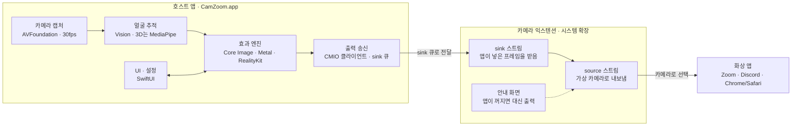
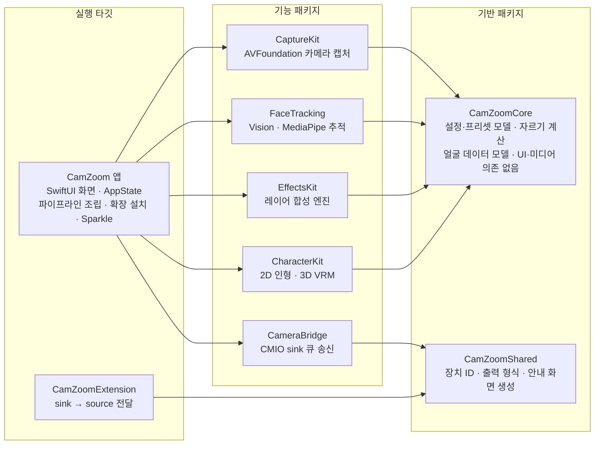
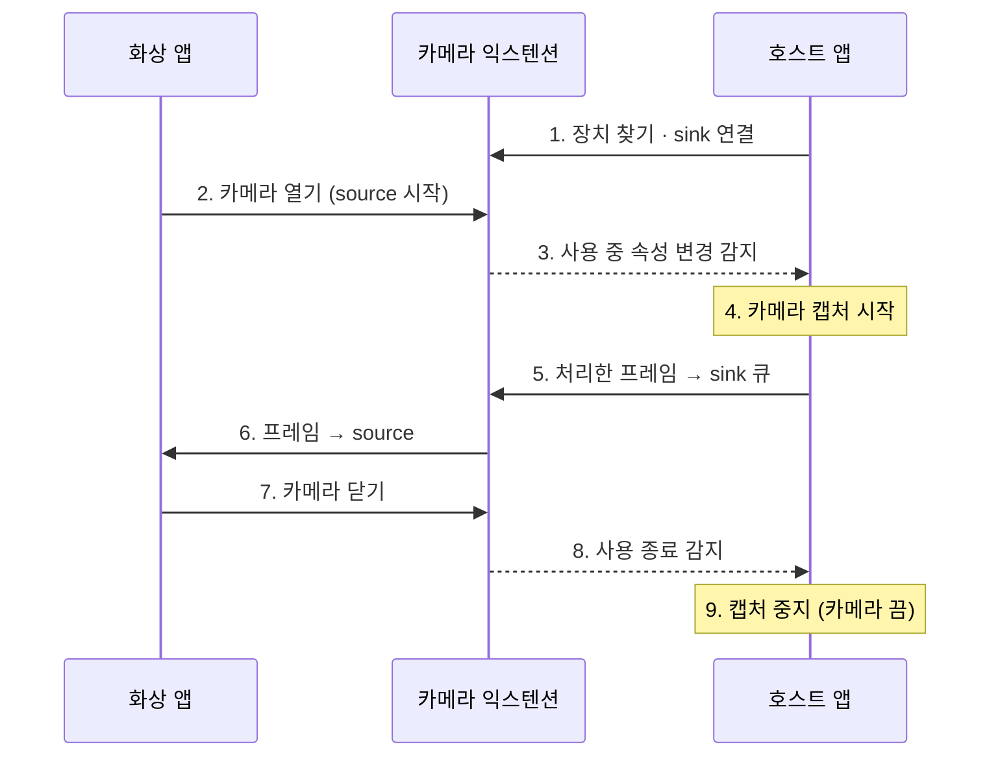

# CamZoom 기술 설계서

2026-10-04 (최종 수정 2026-10-07)

## 1. 개요와 설계 원칙

CamZoom은 호스트 앱이 카메라 캡처부터 효과 합성까지 모든 영상 처리를 맡고, 카메라 익스텐션은 완성된 프레임을 화상 앱에 전달만 하는 2-프로세스 구조로 만든다. 전부 Swift와 애플 기본 프레임워크로 구성하고, 외부 의존성은 Sparkle(업데이트), VRMKit(3D 캐릭터), MediaPipe(3D 표정) 세 개로 제한한다.

이 문서는 [기획서](01-product-plan.md)의 4장(기술 스택)과 9장(개발 환경)을 개발 착수 수준으로 구체화한 것이다. 제품 범위와 일정은 기획서를 따른다.

**설계 원칙**

1. **익스텐션은 얇게**: 익스텐션은 시스템 확장이라 재설치·디버깅 비용이 크다. 로직은 전부 앱과 공용 패키지에 두고, 익스텐션은 프레임 전달과 안내 화면 출력만 한다.
2. **한 프레임, 한 파이프라인**: 미리보기와 실제 출력은 같은 처리 결과를 쓴다. 미리보기용 별도 렌더링을 두지 않아 "미리보기와 다르게 나가는" 문제를 구조적으로 막는다.
3. **GPU에서 시작해 GPU에서 끝내기**: 카메라 버퍼부터 출력 버퍼까지 IOSurface 기반 픽셀 버퍼를 쓰고 CPU 복사를 피한다.
4. **효과는 레이어**: 확대·필터·스티커·캐릭터를 순서가 정해진 레이어로 쌓는다. 새 효과는 레이어 하나를 추가하는 것으로 끝난다.
5. **순수 계산은 테스트 가능하게**: 좌표 계산, 설정 모델, 표정값 변환은 UI·카메라와 분리된 패키지에 두고 단위 테스트로 검증한다.
6. **기기 밖으로 아무것도 보내지 않기**: 네트워크 접근은 업데이트 확인 하나뿐이다.

## 2. 시스템 아키텍처

실행 중에는 프로세스 두 개가 협력한다. 사용자가 실행하는 호스트 앱이 카메라를 직접 열어 모든 처리를 하고, macOS가 띄우는 카메라 익스텐션이 그 결과를 화상 앱에 일반 카메라처럼 내보낸다.



앱은 처리한 프레임을 익스텐션의 sink 스트림 큐에 넣고, 익스텐션은 그 프레임을 source 스트림으로 화상 앱에 내보낸다. UI의 미리보기와 화상 앱 출력은 효과 엔진의 같은 결과를 쓴다.

| 프로세스 | 실행 주체 | 맡는 일 | 권한·제약 |
| --- | --- | --- | --- |
| 호스트 앱 (CamZoom.app) | 사용자 (로그인 시 자동 실행 가능) | 카메라 캡처, 얼굴 추적, 효과 합성, 미리보기, 설정, 확장 설치 | 카메라 권한, 시스템 확장 설치 권한, Hardened Runtime |
| 카메라 익스텐션 | macOS (화상 앱이 카메라를 열면 시작) | sink로 받은 프레임을 source로 전달, 앱이 없을 때 안내 화면 출력 | 샌드박스, 사용자 세션 밖에서 실행, 직접 UI 없음 |
| 화상 앱 (Zoom 등) | 사용자 | 가상 카메라를 일반 카메라로 열어 사용 | 우리 코드가 실행되지 않음 |

## 3. 기술 스택과 버전 확정표

최소 지원은 macOS 14, 3D 캐릭터 모드만 macOS 15 이상이다. 3D 렌더링에 쓸 RealityKit의 RealityRenderer와 VRMKit의 RealityKit 렌더링이 모두 macOS 15부터 동작하기 때문이다. 외부 라이브러리는 아래 표의 세 개 외에는 추가하지 않는다.

| 영역 | 선택 | 버전·요구 사항 | 쓰는 곳 | 도입 단계 |
| --- | --- | --- | --- | --- |
| 언어 | Swift 6 (strict concurrency) | 최신 정식 Xcode | 전체 | 1 |
| UI | SwiftUI + MenuBarExtra | macOS 14+ | 메뉴바 팝오버, 메인·설정·설치 창 | 1 |
| 카메라 입력 | AVFoundation (AVCaptureSession) | macOS 14+ | 카메라 캡처, 장치 전환 | 1 |
| 영상 처리 | Core Image + Metal (CIContext는 Metal 기반) | macOS 14+ | 확대·자르기·필터·합성 | 1 |
| 셰이더 효과 | Metal 커널 (CIKernel) | macOS 14+ | 얼굴 왜곡, 커스텀 필터 | 3 |
| 가상 카메라 | Core Media I/O 카메라 익스텐션 | macOS 12.3+ | 가상 카메라 장치 | 1 |
| 확장 설치 | SystemExtensions (OSSystemExtensionRequest) | macOS 12+ | 익스텐션 설치·교체 | 1 |
| 얼굴 추적 (1차) | Vision 얼굴 랜드마크 (리비전 3, 76점) | macOS 14+ | 스티커 위치, 2D 캐릭터 표정 | 3 |
| 사람 분리 | Vision 사람 분리 요청 | macOS 12+ | 배경 흐림·교체 | 2 |
| 얼굴 추적 (2차) | [MediaPipe Face Landmarker](https://developers.google.com/edge/mediapipe/solutions/vision/face_landmarker) | C 라이브러리 연동, Apache 2.0 | 3D 캐릭터용 52개 표정 계수 | 5 |
| 3D 렌더링 | RealityKit [RealityRenderer](https://developer.apple.com/documentation/realitykit/realityrenderer) | macOS 15+ | 3D 캐릭터를 Metal 텍스처로 렌더링 | 5 |
| 3D 모델 로딩 | [VRMKit](https://github.com/tattn/VRMKit/wiki) | MIT, RealityKit 렌더링은 macOS 15+ | VRM 캐릭터 불러오기 | 5 |
| 자동 업데이트 | [Sparkle 2](https://sparkle-project.org/documentation/upgrading/) | 2.9.x, EdDSA 서명 | 웹사이트 배포 업데이트 | 1 |
| 로그 | OSLog (Logger) | macOS 14+ | 앱·익스텐션 로그, 지원용 로그 내보내기 | 1 |
| 설정 저장 | Codable + JSON 파일 | macOS 14+ | 설정·프리셋 | 1 |
| 테스트 | XCTest + Swift Testing | 최신 Xcode | 단위·스냅샷 테스트 | 1 |
| 패키지 관리 | Swift Package Manager | 최신 Xcode | 내부 패키지, Sparkle, VRMKit | 1 |

**쓰지 않기로 한 것**: SceneKit(WWDC25에서 지원 중단 예고), Live2D(아바타 앱은 별도 계약 필요), DAL 플러그인(구 방식, 지원 종료), Electron 등 웹 기반 UI(카메라 익스텐션과 실시간 영상 처리에 부적합).

## 4. 모듈 구조

실행 타깃 2개, 기능 패키지 5개, 기반 패키지 2개로 나눈다. 의존은 타깃 → 기능 → 기반 방향으로만 흐르고, 기능 패키지끼리는 서로 모른다. 연결은 앱의 파이프라인 조립 코드가 맡는다.



익스텐션은 CamZoomShared 하나만 의존한다. 그래서 효과나 캐릭터 코드를 고쳐도 익스텐션을 다시 설치할 필요가 없다.

| 모듈 | 종류 | 책임 | 의존 |
| --- | --- | --- | --- |
| CamZoom | 앱 타깃 | 화면, 앱 상태, 파이프라인 조립, 확장 설치, 업데이트 | 기능 패키지 전부, Sparkle |
| CamZoomExtension | 카메라 익스텐션 타깃 | 가상 카메라 장치, sink→source 전달, 안내 화면 출력 | CamZoomShared |
| CaptureKit | 패키지 | 카메라 목록(자기 가상 카메라 제외), 캡처 세션, 장치 분리·잠자기 복구 | CamZoomCore |
| FaceTracking | 패키지 | FaceTracker 프로토콜, Vision 구현, MediaPipe 구현(5단계), 값 다듬기 | CamZoomCore |
| EffectsKit | 패키지 | 레이어 프로토콜, 합성기, 기본 효과(자르기·필터·프레임·스티커·왜곡 등) | CamZoomCore |
| CharacterKit | 패키지 | 2D 인형 렌더러, 3D VRM 렌더러(macOS 15+), 캐릭터 파일 로딩 | CamZoomCore, VRMKit |
| CameraBridge | 패키지 | 가상 카메라 장치 찾기, sink 큐에 프레임 넣기, 사용 중 여부 감지 | CamZoomShared |
| CamZoomCore | 패키지 | 설정·프리셋 모델, 자르기 계산, FaceFrame 등 데이터 모델 | 없음 (Foundation·CoreGraphics만) |
| CamZoomShared | 패키지 | 가상 장치·스트림 ID, 출력 형식 목록, 안내 화면 이미지 생성 | 없음 |

**저장소 반영 (2026-10-08)**: `FrameProcessor`는 없애고 EffectsKit의 Compositor로 대체했다. 익스텐션은 CamZoomShared만 의존한다. FaceTracking·CharacterKit은 해당 단계(3·4단계)에서 추가한다.

## 5. 프레임 파이프라인

한 프레임은 캡처 → 합성 → 출력의 세 단계를 33ms(30fps) 안에 통과해야 한다. 얼굴 추적은 이 경로 밖에서 비동기로 돌고, 합성 단계는 가장 최근 추적 결과를 가져다 쓴다. 추적이 늦어도 영상은 끊기지 않는다.

| 단계 | 실행 큐 | 하는 일 | 목표 시간 (M1 기준) |
| --- | --- | --- | --- |
| 1. 캡처 | captureQueue (직렬) | AVCaptureVideoDataOutput에서 픽셀 버퍼 수신, 타임스탬프 기록 | 1ms 이하 |
| 2. 얼굴 추적 | trackingQueue (직렬, 비동기) | 640px로 줄인 프레임을 Vision에 넘겨 FaceFrame 생성, 다듬기 필터 적용 | 10ms 이하, 늦으면 프레임 건너뜀 |
| 3. 합성 | renderQueue (직렬) | 레이어 목록으로 CIImage 그래프 구성, 출력 버퍼에 GPU 렌더링 | 12ms 이하 |
| 4. 출력 | renderQueue | CMSampleBuffer로 감싸 sink 큐에 넣기, 같은 버퍼를 미리보기에 표시 | 1ms 이하 |

목표 시간은 성능 목표(기획서 4.4장)에서 나눈 설계 값이며, 0단계 PoC에서 실측해 조정한다.

**픽셀 형식**

- 입력: `420YpCbCr8BiPlanarFullRange`. 카메라 기본 형식이라 변환 비용이 없고, Vision도 이 형식을 그대로 받는다.
- 출력: `32BGRA`. 화상 앱 호환성이 가장 넓다. 형식 변환은 합성 단계의 GPU 렌더링에 포함돼 추가 비용이 없다.

**버퍼 관리**

- 출력 버퍼는 IOSurface 기반 CVPixelBufferPool에서 꺼낸다. 미리보기 화면과 sink 큐가 같은 버퍼를 복사 없이 공유한다.
- 화상 앱은 받은 버퍼를 한동안 붙잡아 둘 수 있고, 여러 앱이 동시에 쓰면 풀이 바닥나는 사례가 [애플 개발자 포럼](https://developer.apple.com/forums/thread/726417)에 보고돼 있다. 그래서 풀 크기를 넉넉히(최소 8개) 잡고, 바닥나면 버퍼를 개별 할당한 뒤 로그를 남긴다.
- 출력 해상도·비율이 바뀌면 풀을 새로 만든다. 기존 버퍼는 반납될 때까지 그대로 둔다.

**프레임을 버리는 규칙**

- 합성 중인 프레임이 있으면 새 프레임은 버린다(동시에 처리하는 프레임은 1개). 늦은 프레임을 쌓아 지연을 키우는 것보다 낫다.
- 3초 이상 계속 버려지면 효과 품질을 자동으로 낮춘다(기획서 10장 예외 처리).

## 6. 앱↔카메라 익스텐션 통신

앱과 익스텐션은 Core Media I/O가 제공하는 스트림과 장치 속성만으로 통신하고, XPC는 쓰지 않는다. 익스텐션은 장치 하나에 스트림 두 개(앱이 넣는 sink, 화상 앱이 읽는 source)를 열어 둔다. 앱은 화상 앱이 가상 카메라를 열 때만 실제 카메라를 켜서 카메라 표시등과 전력 소모를 줄인다.



점선은 직접 호출이 아니라, 앱이 장치 속성 변화를 감지하는 것이다. 메인 창 미리보기가 열려 있을 때도 카메라를 켠다.

**앱 쪽 (CameraBridge)**

1. CamZoomShared에 정해 둔 장치 UID로 가상 카메라 장치를 찾고, 그 장치의 스트림 목록에서 sink 스트림을 고른다.
2. `CMIOStreamCopyBufferQueue`로 sink 스트림의 큐를 얻고 스트림을 시작한다. 매 프레임은 `CMSimpleQueueEnqueue`로 넣는다. 이 방식은 [애플 개발자 포럼](https://developer.apple.com/forums/thread/706184?page=2)에서 애플 측이 안내한 경로다.
3. 익스텐션이 사용자 정의 속성으로 알려 주는 연결 클라이언트 수에 변경 감지를 달아, 1 이상이면 캡처를 시작하고 0이 되면 멈춘다(13장 G3).
4. 큐가 가득 차 넣기가 실패하면 그 프레임을 버리고 다음 프레임을 보낸다.

**익스텐션 쪽 (CamZoomExtension)**

- sink 스트림은 클라이언트(앱)가 보낸 샘플 버퍼를 꺼내고, source 스트림은 그 버퍼를 화상 앱에 보낸다. 버퍼를 보낸 뒤에는 참조를 오래 붙잡지 않는다.
- source에는 자체 타이머(30fps)를 둔다. 1초 동안 sink에서 프레임이 오지 않으면 "앱을 실행해 주세요" 안내 화면을 내보낸다.
- 안내 화면은 CamZoomShared가 출력 형식에 맞춰 미리 만들어 둔 이미지다. 화상 앱 화면 크기가 바뀌지 않도록 현재 형식과 같은 크기로 보낸다.
- 출력 형식은 1280×720, 1920×1080, 1080×1080 세 가지를 광고하고, 실제 형식은 화상 앱이 고른다. 앱은 고른 형식에 맞춰 합성 시 출력 크기를 맞춘다.

**XPC를 쓰지 않는 이유**: 설정은 전부 앱에 있고 익스텐션은 프레임만 전달하므로 별도 제어 채널이 필요 없다. 나중에 익스텐션에 값을 전달해야 하면 사용자 정의 장치 속성을 추가한다.

## 7. 효과·얼굴 추적·캐릭터 엔진

모든 효과는 같은 인터페이스를 가진 레이어이고, 합성기는 정해진 순서대로 레이어를 쌓아 CIImage 그래프 하나를 만든다. GPU 렌더링은 마지막에 한 번만 일어난다. 얼굴 추적 결과는 프레임마다 FaceFrame 하나로 정리돼 모든 레이어에 같이 전달된다.

### 7.1 레이어 순서

| 순서 | 레이어 | 하는 일 | 얼굴 데이터 | 단계 |
| --- | --- | --- | --- | --- |
| 1 | 자르기·확대 | 확대 위치·배율·비율 적용 | 불필요 | 1 |
| 2 | 배경 | 사람 분리 마스크로 배경 흐림·교체 | 불필요 (분리 마스크 사용) | 2 |
| 3 | 얼굴 왜곡 | 볼록·오목 렌즈, 큰 눈 (Metal 커널) | 필요 | 3 |
| 4 | 캐릭터 | 사람 영역을 2D·3D 캐릭터로 대체 | 필요 | 4·5 |
| 5 | 색 필터 | 흑백, 레트로, 만화풍 등 | 불필요 | 2 |
| 6 | 얼굴 스티커 | 모자·안경·콧수염을 얼굴 위치·기울기에 맞춰 배치 | 필요 | 3 |
| 7 | 오버레이 | 고정 스티커, 이름표, 리액션 파티클 | 불필요 | 2·3 |
| 8 | 프레임 | 폴라로이드, TV, 액자 테두리 | 불필요 | 2 |
| 9 | 출력 맞춤 | 출력 형식에 맞춤 (16:9 안에 정사각형 가운데 배치 등) | 불필요 | 1 |

**순서에 대한 결정**: 색 필터는 캐릭터 뒤에 둬서 필터가 캐릭터까지 같은 톤으로 물들인다. 스티커와 오버레이는 필터 뒤에 둬서 색이 선명하게 남는다. 화면 얼리기는 레이어가 아니라 합성기 옵션이다. 켜지면 마지막 출력 버퍼를 계속 다시 보낸다.

### 7.2 레이어 인터페이스

```swift
protocol EffectLayer {
    var id: LayerID { get }
    var isEnabled: Bool { get }
    var needsFace: Bool { get }
    func apply(_ image: CIImage, context: FrameContext) -> CIImage
}

struct FrameContext {
    let face: FaceFrame?          // 최근 추적 결과, 없으면 nil
    let time: CMTime              // 출력 타임스탬프
    let outputSize: CGSize        // 화상 앱이 고른 출력 형식
    let cropTransform: CGAffineTransform  // 원본 좌표 → 잘린 화면 좌표
}
```

얼굴 좌표는 원본 프레임 기준으로 들어오고, 자르기 뒤의 레이어는 `cropTransform`으로 변환해서 쓴다. 확대해도 스티커가 얼굴에서 벗어나지 않는 이유다.

### 7.3 얼굴 데이터 모델 (FaceFrame)

| 필드 | 내용 | 1차 출처 (Vision) | 2차 출처 (MediaPipe) |
| --- | --- | --- | --- |
| boundingBox | 얼굴 영역, 원본 기준 0~1 좌표 | 얼굴 관찰 결과 | 랜드마크로 계산 |
| landmarks | 눈·눈썹·코·입·윤곽 점 | 76점 | 478점 |
| headPose | roll, yaw, pitch | 얼굴 관찰 결과 | 얼굴 변환 행렬 |
| eyeOpenL / eyeOpenR | 눈 뜸 정도 0~1 | 눈 윤곽 높이÷너비를 보정값으로 정규화 | 눈 깜빡임 계수 |
| mouthOpen | 입 벌림 0~1 | 입술 안쪽 간격÷얼굴 높이 | 턱 벌림 계수 |
| blendshapes | 52개 표정 계수 | 없음 | 있음 |
| confidence | 추적 신뢰도 | 관찰 신뢰도 | 검출 점수 |

- **값 다듬기**: 랜드마크와 표정값은 프레임마다 흔들린다. 속도에 따라 다듬는 정도를 바꾸는 저역 통과 필터(1€ 필터 방식)를 적용해, 가만히 있을 때는 떨림을 없애고 빠르게 움직일 때는 지연을 줄인다.
- **보정**: 첫 실행과 "무표정 기준 다시 잡기"에서 무표정 상태의 눈·입 비율을 저장해 0~1 정규화의 기준으로 쓴다.
- **얼굴을 놓쳤을 때**: 마지막 FaceFrame을 0.5초간 유지하고, 3초가 지나면 스티커·캐릭터를 기본 위치로 옮긴다(기획서 10장).

### 7.4 캐릭터

**2D 캐릭터**(4단계)는 부품 PNG와 설정 JSON을 묶은 폴더 형식으로 정한다. 렌더러는 FaceFrame 값에 따라 부품을 바꾸고 기울여 Core Image로 합성한다.

```json
{
  "format": "camzoom-character",
  "version": 1,
  "name": "말랑이",
  "canvas": [512, 512],
  "parts": {
    "face": "face.png",
    "eyes": { "open": "eyes_open.png", "closed": "eyes_closed.png", "threshold": 0.2 },
    "mouth": ["mouth_0.png", "mouth_1.png", "mouth_2.png"]
  },
  "motion": { "maxRollDegrees": 20, "followYaw": 0.3 }
}
```

**3D 캐릭터**(5단계)는 VRMKit으로 VRM 파일을 불러와 RealityKit RealityRenderer로 매 프레임 Metal 텍스처에 렌더링하고, 그 텍스처를 CIImage로 감싸 4번 레이어에 넣는다. MediaPipe의 52개 계수는 VRM 표준 표정(눈 깜빡임, 입 모양 aa·ih·ou·ee·oh 등)으로 바꿔서 적용한다. 대응표는 5단계 PoC에서 정한다.

**인물 대체 방식**: 캐릭터 레이어는 세 가지 방식으로 사람을 대체한다. 화면 전체를 배경 + 캐릭터로 바꾸는 방식(A)이 기본이고, 실제 영상은 표정을 읽는 데만 쓴다. 얼굴 위치·기울기에 맞춰 머리만 덮는 방식(C)은 3단계 얼굴 스티커와 같은 경로로 처리한다. 사람만 지우고 실제 배경을 남기는 방식(B)은 Vision 사람 분리 마스크로 사람 영역을 지운 뒤 미리 찍은 빈 배경 사진(또는 흐림)으로 채우고 캐릭터를 그린다. B는 게이트 C의 C5·C6을 통과해야 포함한다. 사진 속 인물을 내 표정대로 움직이는 방식은 맥 실시간 성능 근거가 없고 악용 위험이 있어 보류한다(종합 문서 6장).

## 8. 상태 관리와 저장

앱 상태는 메인 스레드의 AppState 하나가 갖고, 파이프라인은 그 상태를 복사한 불변 스냅샷(PipelineConfig)만 읽는다. 사용자가 슬라이더를 움직이면 새 스냅샷이 만들어져 렌더 큐에 통째로 교체된다. 프레임 처리 중에는 잠금이 필요 없다.

### 8.1 상태 구성

| 상태 | 내용 | 저장 여부 |
| --- | --- | --- |
| CropState | 확대 배율, 확대 위치, 자르기 비율 | 저장 |
| DecorState | 필터, 프레임, 배경 흐림·교체, 고정 스티커, 이름표 | 저장 |
| EffectState | 얼굴 스티커 종류, 왜곡, 리액션 | 저장 (화면 얼리기는 저장 안 함) |
| CharacterState | 선택한 캐릭터, 무표정 보정값 | 저장 |
| OutputSettings | 입력 카메라, 정사각형 출력 방식, 효과 전체 켜기·끄기 | 저장 |
| AppPreferences | 화면 모드(시스템·라이트·다크), 단축키, 자동 실행, 메뉴바만 표시 | 저장 |
| RuntimeState | 카메라 연결 상태, 가상 카메라 사용 여부, 현재 FPS, 오류 메시지 | 저장 안 함 |

### 8.2 저장 위치와 형식

- 앱 지원 폴더(`Application Support/CamZoom/`)에 JSON 파일로 저장한다. UserDefaults 대신 파일을 쓰는 이유는 프리셋을 파일로 내보내고 공유하기 쉬워서다.
- `settings.json`: 현재 상태 전체. 변경 후 0.5초 동안 추가 변경이 없으면 한 번에 쓴다.
- `presets/<id>.json`: 프리셋 하나당 파일 하나.
- `characters/<이름>/`: 사용자가 불러온 2D 캐릭터 폴더와 VRM 파일.
- 영상 프레임과 얼굴 데이터는 어디에도 저장하지 않는다.

```json
{
  "schemaVersion": 1,
  "id": "8F2C1A90-5B1E-4C6D-9A3F-1D2E3F4A5B6C",
  "name": "눈코 확대",
  "crop": { "zoom": 2.2, "centerX": 0.52, "centerY": 0.44, "aspect": "square" },
  "decor": { "filter": "retro", "frame": "none", "backgroundBlur": false },
  "effects": { "faceSticker": "glasses", "distortion": false, "reaction": false },
  "character": null
}
```

### 8.3 형식 변경(마이그레이션)

- 모든 파일에 `schemaVersion`을 넣는다. 읽을 때 버전이 낮으면 1→2→3 순서로 변환 함수를 거친다.
- 모르는 필드는 무시하고, 없는 필드는 기본값으로 채운다. 새 버전에서 필드를 추가해도 이전 파일이 깨지지 않는다.
- 해석에 실패한 파일은 `.broken` 이름으로 옮겨 두고 기본값으로 시작한다. 앱이 설정 파일 때문에 죽는 일은 없어야 한다.

**저장소 반영 (2026-10-08)**: `CropState`는 UserDefaults 대신 SettingsStore(`settings.json`, `presets/<id>.json`)로 저장한다.

## 9. 동시성·성능·전력 관리

Swift 6 strict concurrency를 켜고, 프레임 경로는 액터 대신 전용 직렬 큐 세 개로 돌린다. 프레임마다 액터를 오가는 비용과 지연을 피하기 위해서다. 큐 사이에는 Sendable 값(픽셀 버퍼, FaceFrame, PipelineConfig 스냅샷)만 넘긴다.

### 9.1 실행 위치

| 실행 위치 | 우선순위(QoS) | 맡는 일 |
| --- | --- | --- |
| MainActor | 기본 | SwiftUI 화면, AppState, 설정 저장 예약 |
| captureQueue | userInteractive | AVFoundation 캡처 콜백 |
| trackingQueue | userInitiated | Vision·MediaPipe 얼굴 추적, 사람 분리 |
| renderQueue | userInteractive | 레이어 합성, GPU 렌더링, sink 큐 송신 |

- 설정 스냅샷 교체는 `OSAllocatedUnfairLock`(macOS 13+)으로 감싼 참조 하나를 바꾸는 것으로 끝낸다. 렌더 큐는 프레임 시작 시 한 번만 읽는다.
- 최신 FaceFrame도 같은 방식으로 교체한다. 렌더 큐는 기다리지 않고 그 순간의 최신 값을 쓴다.
- CIContext는 앱 전체에서 하나만 만들어 재사용한다. 만들 때마다 GPU 자원을 새로 잡아 느려지기 때문이다.

### 9.2 전력 절약

- 화상 앱이 가상 카메라를 쓰지 않고 미리보기 창도 닫혀 있으면 카메라 캡처를 완전히 멈춘다(6장).
- 효과가 모두 꺼져 있으면 얼굴 추적과 사람 분리를 돌리지 않는다. 필요한 레이어가 켜졌을 때만 추적을 시작한다.
- 얼굴 추적 입력은 640px로 줄이고, 사람 분리는 기본 품질을 '균형'으로 둔다.

### 9.3 자동 품질 낮춤

발열 상태(ProcessInfo의 thermal state), 저전력 모드, 3초 이상 이어지는 프레임 누락 중 하나라도 나타나면 한 단계씩 낮춘다. 상태가 회복되고 30초가 지나면 한 단계씩 되돌린다.

| 단계 | 조건 | 바뀌는 것 |
| --- | --- | --- |
| 0 | 정상 | 추적 30fps, 사람 분리 '균형', 모든 효과 |
| 1 | 발열 '보통' 또는 저전력 모드 | 추적 15fps, 사람 분리 '빠름' |
| 2 | 발열 '심각' 또는 프레임 누락 지속 | 추적 10fps, 얼굴 왜곡 끔, 3D 캐릭터는 2D로 대체 |
| 3 | 발열 '위험' | 출력 15fps, 배경 처리 끔, 캐릭터 끔 (조절만 유지) |

단계가 바뀌면 메뉴바 팝오버에 한 줄로 알린다. 사용자는 설정에서 자동 품질 낮춤을 끌 수 있다.

**저장소 반영 (2026-10-11)**: 단계 계산은 `CamZoomCore/QualityLevel.swift`(QualityGovernor), 시스템 상태 읽기는 앱의 `QualityMonitor`가 한다. "프레임 누락 지속"은 1초 구간에서 프레임의 10% 이상을 버린 상태가 3초 이어질 때로 임시로 정했고, 게이트 B 결과로 확정한다. 1단계에서 실제로 바뀌는 것은 3단계의 출력 15fps 제한뿐이고, 나머지 값은 해당 기능이 들어오는 단계에서 읽는다.

### 9.4 측정

- 각 단계에 `os_signpost` 구간을 넣어 Instruments에서 단계별 시간을 바로 본다.
- 개발 빌드에는 미리보기 구석에 FPS·단계별 시간·버린 프레임 수를 보여주는 디버그 오버레이를 둔다.

## 10. 빌드·서명·배포 파이프라인과 CI

CI는 GitHub Actions의 macOS 러너에서 돌리고, 작업은 세 종류로 나눈다. PR과 main은 빌드와 테스트만 하고, `v*` 태그가 붙으면 서명·공증·DMG·업데이트 피드까지 자동으로 만든다. 서명 인증서와 키는 저장소 비밀값으로만 다룬다.

| 트리거 | 작업 | 산출물 |
| --- | --- | --- |
| Pull Request | 패키지 단위 테스트(`swift test`), 앱·익스텐션 서명 없는 빌드, 스냅샷 테스트 | 테스트 결과 |
| main 브랜치 푸시 | PR과 같음 + 개발용 서명 빌드 | 내부 테스트용 앱 (CI 보관 7일) |
| `v*` 태그 | 아카이브 → Developer ID 서명 → 공증 → 스테이플 → DMG → Sparkle 피드 생성 | 서명된 DMG, appcast.xml, GitHub Release |

### 10.1 릴리스 작업 단계

1. 버전 확인: 태그 `v1.2.0`이 앱의 버전 문자열과 같은지 검사한다. 다르면 실패시킨다.
2. 아카이브: `xcodebuild archive`로 앱과 익스텐션을 함께 빌드한다.
3. 서명: 임시 키체인에 Developer ID 인증서를 넣고, 익스텐션 → 앱 순서로 서명한다(안쪽부터 바깥쪽). Hardened Runtime을 켠다.
4. 공증: `notarytool`로 제출하고 결과를 기다린 뒤, `stapler`로 공증 티켓을 붙인다.
5. DMG: 앱과 "응용 프로그램" 폴더 바로가기를 넣은 DMG를 만들고, DMG도 서명·공증한다.
6. 업데이트 피드: Sparkle의 `generate_appcast`로 EdDSA 서명이 들어간 appcast.xml을 만든다.
7. 게시: DMG를 GitHub Release에 올리고 appcast.xml을 웹사이트에 반영한다.

### 10.2 비밀값

| 비밀값 | 용도 |
| --- | --- |
| Developer ID Application 인증서(.p12) + 비밀번호 | 앱·익스텐션·DMG 서명 |
| 프로비저닝 프로파일 (앱, 익스텐션) | 시스템 확장 설치 권한 등 엔타이틀먼트 |
| App Store Connect API 키 | `notarytool` 공증 제출 |
| Sparkle EdDSA 개인 키 | 업데이트 피드 서명 |

- 비밀값은 CI 안에서만 쓰고, 개발자 맥에는 Sparkle 개인 키를 두지 않는다.
- 시스템 확장은 서명이 맞지 않으면 설치되지 않으므로, 릴리스 작업 마지막에 서명·공증 상태를 검사하는 단계를 넣는다(`codesign --verify`, `spctl --assess`).

### 10.3 개발자 로컬 빌드

- 익스텐션은 앱이 "응용 프로그램" 폴더에 있어야 활성화된다. 빌드 후 앱을 그 폴더로 복사하고 실행하는 스크립트(`scripts/install-dev.sh`)를 둔다.
- 익스텐션 코드를 바꾸지 않았다면 재설치가 필요 없다. 4장의 모듈 분리 덕분에 대부분의 작업은 앱만 다시 빌드하면 된다.

## 11. 테스트 전략

카메라와 화상 앱이 필요 없는 부분은 CI에서 자동으로, 실제 카메라·가상 카메라·화상 앱이 필요한 부분은 릴리스 전 체크리스트로 수동 검증한다. 자동 테스트가 실제 카메라에 의존하지 않도록, 캡처 단계는 녹화 영상이나 정지 이미지를 넣는 가짜 입력으로 바꿀 수 있게 만든다.

| 종류 | 대상 | 방법 | 실행 시점 |
| --- | --- | --- | --- |
| 단위 테스트 | 자르기 계산, 설정·프리셋 인코딩, 마이그레이션, 표정값 정규화, 값 다듬기 필터 | XCTest·Swift Testing, 패키지별 `swift test` | 모든 PR |
| 스냅샷 테스트 | 레이어별 합성 결과 (필터, 프레임, 스티커 위치, 출력 맞춤) | 고정 입력 이미지 + 고정 FaceFrame으로 렌더링해 기준 이미지와 픽셀 비교 (허용 오차 지정) | 모든 PR |
| 추적 회귀 테스트 | Vision 얼굴 추적 → FaceFrame 변환 | 사람 얼굴이 담긴 테스트 영상 몇 개로 눈 깜빡임·입 벌림 감지 여부 확인 | main 푸시 |
| 성능 테스트 | 합성 단계 시간 | 고정 입력 300프레임 합성 시간 측정, 기준보다 20% 이상 느려지면 경고 | main 푸시 |
| 통합 테스트 (수동) | 가상 카메라 설치·인식, sink→source 전달, 안내 화면 | 기획서 11.1 호환성 표 순서로 확인 | 릴리스 전 |
| 설치 테스트 (수동) | 첫 실행부터 Zoom 적용까지 | 깨끗한 맥 또는 새 사용자 계정에서 설치 안내 흐름 진행 | 릴리스 전 |

- 테스트 영상은 팀원 본인 얼굴로만 만들고 저장소에 포함하기 전에 동의를 받는다. 외부 데이터셋 얼굴은 쓰지 않는다.
- 스냅샷 기준 이미지는 GPU와 macOS 버전에 따라 미세하게 달라질 수 있다. CI 러너 기준으로 만들고, 허용 오차를 둔다.

## 12. 기술 결정 기록 (ADR 요약)

되돌리기 어려운 결정 10건을 기록한다. 결정을 바꿀 때는 이 표에 새 줄을 추가하고, 이전 줄의 상태를 "대체됨"으로 바꾼다.

| 번호 | 결정 | 고려한 대안 | 이유 |
| --- | --- | --- | --- |
| ADR-01 | 전부 Swift 네이티브로 개발 | Electron, Tauri | 카메라 익스텐션은 네이티브여야 하고, 실시간 영상 처리를 웹 레이어와 주고받으면 지연과 용량이 커짐 |
| ADR-02 | 영상 처리는 앱에서, 익스텐션은 전달만 | 익스텐션이 직접 캡처·처리 | 익스텐션은 재설치·디버깅 비용이 큼. 로직이 앱에 있으면 익스텐션 수정 빈도가 거의 0 |
| ADR-03 | 앱→익스텐션 전달은 CMIO sink 스트림 | XPC, 공유 메모리 직접 구현 | 애플이 안내한 공식 경로. 별도 통신 계층 불필요 |
| ADR-04 | 영상 처리는 Core Image + Metal | 순수 Metal 렌더 파이프라인 | 레이어 조합이 쉽고 필터가 기본 제공됨. 필요한 곳(왜곡)만 Metal 커널로 보강 |
| ADR-05 | 프레임 경로는 직렬 큐 3개 | 프레임마다 Swift 액터 사용 | 액터 전환 비용과 실행 순서 예측 어려움을 피함. 큐 사이에는 Sendable 값만 전달 |
| ADR-06 | 1차 얼굴 추적은 Vision, 3D만 MediaPipe | 처음부터 MediaPipe | Vision은 기본 내장이라 연동 위험이 없음. MediaPipe 연동은 5단계까지 미룸 |
| ADR-07 | 2D 캐릭터는 자체 부품 형식 | Live2D | 아바타 앱의 Live2D 사용은 별도 계약 필요. 무료 배포 원칙과 충돌 |
| ADR-08 | 3D는 RealityKit + VRMKit | SceneKit, Unity 임베드 | SceneKit은 지원 중단 예고. RealityRenderer가 macOS 15부터 Metal 텍스처 렌더링 지원 |
| ADR-09 | 설정은 JSON 파일 저장 | UserDefaults | 프리셋 내보내기·공유와 버전별 마이그레이션이 쉬움 |
| ADR-10 | 기본 출력은 16:9, 정사각형은 가운데 배치 | 정사각형 형식 그대로 출력 | 화상 앱마다 정사각형 형식 처리가 달라 잘리거나 거부될 위험. 원본 정사각형은 선택 형식으로 유지 |

## 13. 설계 검토 결과: 빠진 부분 16건

설계서를 애플 문서와 개발자 포럼 사례에 대조해 빠진 부분 16건을 찾았다. 그중 6건은 출시를 막을 수 있는 수준이라 구현 전 검증 대상으로 올린다. 각 항목의 검증 방법과 통과 기준은 [기술 검증 계획](03-verification-plan.md)에 있다.

| 번호 | 심각도 | 빠진 내용 | 보완 | 반영 위치 |
| --- | --- | --- | --- | --- |
| G1 | 높음 | 확장을 처음 설치하거나 업데이트한 직후, 앱을 재시작해야 가상 카메라가 보이는 사례가 [보고돼 있다](https://developer.apple.com/forums/thread/734259). 사진 부스 같은 화상 앱도 재시작해야 바뀐 장치를 인식했다 | 설치 안내 마지막에 "앱 다시 열기" 단계 추가, 화상 앱 재시작 안내 문구 추가 | 6장, 기획서 6.1 |
| G2 | 높음 | 삭제 흐름이 없다. 앱을 휴지통에 넣어도 시스템 확장이 남는 버그가 [macOS 15.3과 26에서 보고됐다](https://obdev.at/blog/deletion-impossible-2) | 앱 메뉴에 "가상 카메라 제거" 추가(설치한 앱 자신이 제거 요청). 실패 시 시스템 설정에서 직접 삭제하는 안내 제공 | 6장, 10장 |
| G3 | 높음 | 6장은 장치의 '사용 중' 속성으로 사용 여부를 감지한다고 가정했지만 확인되지 않았다. 포럼에서는 익스텐션이 [사용자 정의 속성으로 클라이언트 수를 노출](https://developer.apple.com/forums/thread/709204)하는 방식을 쓴다 | 익스텐션이 연결된 클라이언트 수를 사용자 정의 속성으로 알려 주고 앱이 읽는 방식으로 변경. PoC에서 두 방식을 비교 | 6장 |
| G4 | 높음 | 메뉴바 앱은 창이 보이지 않으면 App Nap 대상이 돼 CPU 사용이 제한된다 | 스트리밍 중에는 ProcessInfo 활동(userInitiated + latencyCritical)을 유지하고, 끝나면 해제 | 9장 |
| G5 | 높음 | 앱과 익스텐션 버전이 어긋나는 경우(앱만 업데이트, 확장 승인 대기, 삭제 실패)를 다루지 않는다. 확장 교체는 빌드 번호가 올라가야 일어난다 | 익스텐션이 프로토콜 버전을 사용자 정의 속성으로 노출. 앱이 시작할 때 확인하고, 다르면 교체를 요청하고 안내 | 6장, 10장 |
| G6 | 높음 | Discord 맥 앱에서 가상 카메라가 보이는지 근거가 부족하다. 예전 방식(DAL 플러그인) 시절에는 Zoom에서 되고 [Discord 앱에서는 안 보이는](https://obsproject.com/forum/threads/obs-virtual-cam-to-discord.133437) 사례가 많았다. Discord 웹은 동작했다 | PoC 최우선 항목으로 검증. 실패하면 Discord 웹 사용 안내와 호환성 표 공개 | 검증 계획 |
| G7 | 중간 | 출력 버퍼의 색 공간(BT.709)과 밝기 범위(전체/제한) 표시 규칙이 없다. 틀리면 화상 앱에서 색이 바래 보인다 | 출력 버퍼에 색 공간 정보를 명시하고, 색 막대 테스트 이미지로 화상 앱별 확인 | 5장 |
| G8 | 중간 | 화상 앱은 고른 카메라를 장치 UID로 기억하는데, UID 관리 규칙이 없다 | 장치·스트림 UID는 첫 출시 후 절대 바꾸지 않는다. 표시 이름은 바꿀 수 있다 | 4장 (CamZoomShared) |
| G9 | 중간 | 프레임 레이트 협상 규칙이 없다 | 1차는 30fps만 광고. 15fps를 요청하는 앱이 PoC에서 발견되면 추가 | 6장 |
| G10 | 중간 | sink로 넣는 프레임의 타임스탬프 규칙이 없다 | 호스트 시간 기준, 단조 증가 보장. 앱 재시작 후에도 되돌아가지 않게 처리 | 5장 |
| G11 | 중간 | 전역 단축키 구현 방식이 정해지지 않았다. 일반 키 입력 감시는 손쉬운 사용 권한이 필요하다 | 권한 없이 등록하는 시스템 핫키 방식 사용 | 3장 |
| G12 | 중간 | 로그인 시 자동 실행 구현 방법이 없다 | SMAppService(macOS 13+) 사용 | 3장 |
| G13 | 중간 | 분석 SDK 없이 충돌 원인을 모을 방법이 없다 | 기기 안에서 MetricKit 진단을 받아 로그 내보내기에 포함. 사용자가 직접 첨부 (반영: 설정 > 문제 신고 > 진단 정보 내보내기) | 10장 |
| G14 | 중간 | 장시간 실행 안정성(메모리 누수, 버퍼 풀 고갈) 테스트가 없다 | 2시간 연속 실행 테스트를 릴리스 전 필수 항목으로 추가 | 11장 |
| G15 | 낮음 | macOS 기본 비디오 효과(인물 모드, 센터 스테이지)를 켜면 호스트 앱이 받는 영상에 이미 적용돼 출력에 섞인다 | 앱 설정에 안내 문구 추가, 이중 효과 여부를 PoC에서 확인 | 6장 |
| G16 | 낮음 | 개발 중 확장을 교체하려면 매번 빌드 번호를 올려야 해서 [번거롭다](https://developer.apple.com/forums/thread/739696) | 개발용 설치 스크립트가 빌드 번호를 자동으로 올림 | 10.3 |

## 14. PoC 요약과 미해결 질문

아래 목록은 요약이다. 게이트별 검증 항목 25개, 통과 기준, 실패 시 대안, 측정 방법, 기술 확정 체크리스트는 [기술 검증 계획](03-verification-plan.md)에 있다.

0단계 PoC는 1~2주 동안 아래 6개 항목을 검증한다. 기획서의 미해결 질문 중 RealityKit 오프스크린 렌더링은 [RealityRenderer 문서](https://developer.apple.com/documentation/realitykit/realityrenderer)로 macOS 15부터 지원됨을 확인했으므로, 가능 여부 대신 성능만 확인한다.

- [ ] **가상 카메라 왕복**: Xcode 템플릿 익스텐션에 sink 스트림을 추가하고, 앱에서 단색 프레임을 넣어 QuickTime에서 보이는지 확인한다. 성공 기준: 30fps로 10분 이상 끊김 없음.
- [ ] **화상 앱 호환성**: Zoom, Discord, ZEP(Chrome·Safari)에서 1280×720, 1920×1080, 1080×1080 형식이 각각 어떻게 보이는지 기록한다. 성공 기준: 16:9 형식이 네 곳 모두에서 정상 표시.
- [ ] **실제 카메라 → 확대 → 출력**: 현재 저장소의 자르기 코드를 파이프라인에 연결한다. 성공 기준: 카메라 입력부터 Zoom 화면까지 지연 100ms 이하.
- [ ] **사용 중 감지**: 가상 카메라를 쓰는 앱이 없을 때 캡처가 멈추고 카메라 표시등이 꺼지는지 확인한다.
- [ ] **앱 꺼짐 처리**: 앱을 강제 종료했을 때 1초 안에 안내 화면으로 바뀌는지 확인한다.
- [ ] **서명·설치 흐름**: Developer ID로 서명·공증한 빌드를 다른 맥에서 설치해 확장 승인까지 마친다.

**미해결 질문**

- 여러 화상 앱이 동시에 가상 카메라를 열 때 버퍼 풀 크기는 얼마가 적당한가 (PoC에서 2개 앱 동시 실행으로 측정)
- MediaPipe C 라이브러리를 서명·공증된 앱에 넣는 구체적인 빌드 방법 (5단계 착수 전 별도 PoC)
- MediaPipe 52개 계수 → VRM 표정 대응표 (5단계)
- 시스템 확장 활성화 조건(응용 프로그램 폴더 위치)이 최신 macOS에서도 같은지

### 출처

- [Apple: RealityRenderer](https://developer.apple.com/documentation/realitykit/realityrenderer)
- [Apple 개발자 포럼: 앱에서 CMIO 익스텐션으로 프레임 보내기](https://developer.apple.com/forums/thread/706184?page=2)
- [Apple 개발자 포럼: sink 스트림 버퍼링과 버퍼 풀 고갈](https://developer.apple.com/forums/thread/726417)
- [Apple 개발자 포럼: 확장 활성화 직후 장치가 보이지 않음](https://developer.apple.com/forums/thread/734259)
- [Apple 개발자 포럼: 카메라 익스텐션 사용 여부 확인](https://developer.apple.com/forums/thread/709204)
- [Apple 개발자 포럼: 휴지통 삭제 후 확장 잔존](https://developer.apple.com/forums/thread/739696)
- [Objective Development: Deletion Impossible 2](https://obdev.at/blog/deletion-impossible-2)
- [OBS 포럼: Discord 가상 카메라 미표시](https://obsproject.com/forum/threads/obs-virtual-cam-to-discord.133437)
- [Sparkle 업그레이드 문서](https://sparkle-project.org/documentation/upgrading/)
- [MediaPipe Face Landmarker](https://developers.google.com/edge/mediapipe/solutions/vision/face_landmarker)
- [VRMKit](https://github.com/tattn/VRMKit/wiki)
- [CamZoom 기획서](01-product-plan.md)
