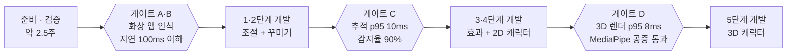

# 기술 검증 계획

[기술 설계서](02-technical-design.md)의 두 번째 탭. 2026-10-07 기준.

## 1. 검증 원칙과 게이트

구현 전에 가장 불확실한 것부터 실제 코드와 실제 화상 앱으로 확인한다. 문서나 포럼에서 확인한 사실도 우리 환경에서 재현하기 전까지는 확정으로 보지 않는다.

게이트 A·B는 1단계 전에 한 번에 끝내고, C와 D는 해당 기능을 만들기 직전에 진행한다. 그림의 기준은 항목별 대표값이고, 전체 기준은 2장에 있다. 게이트에서 실패하면 정해 둔 대안을 적용하고 진행하거나, 해당 기능을 다음 단계로 미룬다.

**검증 원칙**

1. **위험한 것부터**: 실패하면 제품이 성립하지 않는 항목(가상 카메라, 화상 앱 호환성)을 가장 먼저 확인한다.
2. **숫자로 판정**: 모든 항목에 통과 기준 수치를 미리 정한다. 결과를 본 뒤에 기준을 바꾸지 않는다.
3. **실패 대안을 미리**: 실패했을 때 할 일을 항목마다 적어 둔다. 실패가 공사 중단이 아니라 결정으로 이어진다.
4. **버릴 코드로**: PoC 코드는 별도 브랜치에 두고, 검증이 끝나면 설계서 구조대로 다시 짠다. 가짜 입력과 측정 도구만 본 코드로 가져간다.
5. **일반 사용자 환경에서**: 설치·삭제는 개발 맥이 아닌 새 사용자 계정에서, 서명·공증된 빌드로 확인한다.

## 2. 검증 항목 상세

검증 항목은 4개 게이트에 25개다. 항목마다 수치로 된 통과 기준과 실패했을 때의 대안을 미리 정해 두고, 결과가 나오면 대안 중 무엇을 택할지 그 자리에서 결정한다. 괄호 안 G번호는 설계서 13장의 빠진 부분과 연결된다.

### 게이트 A: 가상 카메라 기반 (1주차)

| ID | 검증 질문 | 방법 | 통과 기준 | 실패 시 |
| --- | --- | --- | --- | --- |
| A1 | 앱→sink→source 왕복이 안정적인가 | Xcode 템플릿 익스텐션에 sink 추가, 앱에서 프레임 번호를 그린 단색 프레임 전송, QuickTime으로 확인 | 30fps로 10분, 누락 1% 미만 | 버퍼 큐 깊이·풀 크기 조정 후 재시험 |
| A2 | 화상 앱마다 가상 카메라가 보이고 영상이 나오는가 (G6) | Zoom, Discord 앱, Discord 웹, ZEP(Chrome·Safari), Google Meet, FaceTime에서 선택·표시 | Zoom, ZEP, Discord(앱 또는 웹)에서 모두 표시 | Discord 앱만 실패하면 웹 사용 안내 + 호환성 표에 명시. Zoom·ZEP 실패면 출시 보류 |
| A3 | 출력 형식별로 화상 앱이 어떻게 보여주는가 | 1280×720, 1920×1080, 1080×1080을 앱별로 선택해 잘림·여백·거부 여부 기록 | 16:9 두 형식이 모든 앱에서 정상 | 문제 형식은 광고 목록에서 제외 |
| A4 | 화상 앱의 사용 시작·종료를 감지할 수 있는가 (G3) | 사용자 정의 속성(클라이언트 수)과 장치 기본 속성 두 방식 비교 | 열고 닫은 뒤 1초 안에 감지, 실제 카메라 표시등 꺼짐 | 감지 실패 시 미리보기 창이나 메뉴바 토글로 수동 켜기·끄기 |
| A5 | 앱이 꺼지면 안내 화면으로 바뀌는가 | 앱 강제 종료 → 화상 앱 화면 확인, 재실행 → 복구 확인 | 1초 안에 안내 화면, 재실행 후 3초 안에 복구 | 익스텐션 타이머 주기 조정 |
| A6 | 설치·업데이트·삭제가 일반 사용자 환경에서 되는가 (G1·G2·G16) | 서명·공증 빌드를 새 사용자 계정에서 설치 → 승인 → 앱 재시작 필요 여부 기록 → 빌드 번호 올린 버전으로 교체 → 앱 메뉴로 제거 → 휴지통 삭제 후 잔존 확인 | 설치 5분 이내, 앱 메뉴 제거 후 잔존 0, 각 단계 결과를 macOS 버전별로 기록 | 설치 안내와 FAQ에 수동 절차 추가 |
| A7 | 앱이 익스텐션 버전을 알아낼 수 있는가 (G5) | 익스텐션이 프로토콜 버전을 사용자 정의 속성으로 노출, 앱이 시작 시 읽기 | 버전 불일치를 시작 3초 안에 감지 | 장치 표시 이름에 버전 표기 후 앱이 이름으로 판단 |

### 게이트 B: 파이프라인 성능·안정성 (2주차)

| ID | 검증 질문 | 방법 | 통과 기준 | 실패 시 |
| --- | --- | --- | --- | --- |
| B1 | 카메라→화상 앱 지연이 충분히 짧은가 | 4장의 지연 측정법으로 20회 측정 | 중앙값 100ms 이하 | 동시 처리 프레임 수·큐 깊이 축소 |
| B2 | 합성이 시간 안에 끝나는가 | 확대+필터+프레임 레이어 켠 상태로 300프레임 측정 | 합성 단계 p95 12ms 이하 | 필터를 저해상도에서 적용 후 확대 |
| B3 | 전력 소모가 적당한가 | 조절 모드 30분, Instruments로 CPU·전력 기록 | M1 기준 CPU 10% 이하 | 입력 해상도 720p로 낮추기 |
| B4 | 메뉴바만 남겼을 때 처리가 느려지지 않는가 (G4) | 창 닫고 30분, ProcessInfo 활동 유무로 비교 | 활동 유지 시 30fps 유지 | 스트리밍 중 창을 화면 밖에 유지하는 우회책 검토 |
| B5 | 오래 켜 둬도 안정적인가 (G14) | 2시간 연속 출력, 메모리·버퍼 수 기록 | 메모리 증가 50MB 미만, 버퍼 고갈 0회 | 누수 지점 수정 전 출시 보류 |
| B6 | 두 앱이 동시에 써도 되는가 | Zoom과 QuickTime 동시 사용 10분 | 풀 크기 8에서 누락 1% 미만 | 풀 크기 증가 또는 개별 할당 |
| B7 | 색이 정확하게 나가는가 (G7) | 색 막대 이미지를 출력하고 화상 앱 화면을 캡처해 색값 비교 | 주요 색 RGB 차이 각 채널 8 이하 | 색 공간 태그·범위 조정 |
| B8 | macOS 기본 효과와 겹치지 않는가 (G15) | 인물 모드·센터 스테이지 켠 상태로 출력 확인 | 동작 방식 기록 (통과 기준 없음) | 앱 안내 문구로 대응 |

### 게이트 C: 얼굴 추적 품질 (3단계 착수 전)

| ID | 검증 질문 | 방법 | 통과 기준 | 실패 시 |
| --- | --- | --- | --- | --- |
| C1 | Vision 추적이 빠른가 | 640px 입력, 랜드마크 요청 1,000회 | M1 기준 p95 10ms 이하 | 추적 15fps로 낮추고 보간 |
| C2 | 눈 깜빡임·입 벌림을 잡는가 | 직접 촬영해 라벨링한 테스트 영상 5개 | 감지율 90% 이상, 오감지 5% 이하 | 정규화 기준값·임계값 조정, 안 되면 MediaPipe 조기 도입 검토 |
| C3 | 스티커가 떨리지 않고 따라오는가 | 가만히 30초, 빠르게 고개 돌리기 10회 | 정지 시 떨림 2px 이하(720p 기준), 움직임 지연 2프레임 이하 | 다듬기 필터 계수 조정 |
| C4 | 어려운 조건에서 버티는가 | 역광, 어두운 방, 안경, 고개 30도 돌림 | 조건별 추적 유지율 기록, 어두운 방 80% 이상 | 얼굴을 놓쳤을 때 동작(설계서 7.3)으로 대응 |
| C5 | 사람 분리가 충분히 빠르고 경계가 깨끗한가 (사람만 대체하는 B 방식) | Vision 사람 분리를 '균형' 품질로 720p 300프레임 처리 | p95 15ms 이하, 머리카락·어깨 경계 깨짐 기록 | '빠름' 품질 + 경계 흐림 처리 |
| C6 | 빈 배경 사진으로 사람을 지운 합성이 자연스러운가 | 배경 촬영 후 10분 통화, 조명 변화와 노트북 각도 변화 포함 | 팀 내부 평가로 결정 (주관 평가), 경계 깨짐 빈도 기록 | 빈 배경 대신 흐림으로 채우기, 안 되면 B 방식 제외 |

### 게이트 D: 3D 캐릭터 (5단계 착수 전, 별도 일정)

| ID | 검증 질문 | 방법 | 통과 기준 | 실패 시 |
| --- | --- | --- | --- | --- |
| D1 | RealityRenderer로 매 프레임 렌더링이 빠른가 | VRM 캐릭터 1개를 720p 텍스처로 렌더링 | p95 8ms 이하 | 렌더 해상도 축소 또는 Metal 직접 렌더링 |
| D2 | MediaPipe를 서명·공증된 앱에 넣을 수 있는가 | C 라이브러리 연동 빌드 → 서명·공증 → 다른 맥에서 실행 | 공증 통과, 52개 계수 30fps | 3D 캐릭터도 Vision 기반 간이 표정으로 대체 |
| D3 | VRM 파일을 안정적으로 불러오는가 | 공개 샘플 VRM 3종 로딩 | 3종 모두 표시, 표정 키 확인 | 지원 VRM 버전 제한 |
| D4 | 52개 계수를 VRM 표정으로 자연스럽게 옮기는가 | 대응표 초안으로 테스트 영상 재생 | 팀 내부 평가로 결정 (주관 평가) | 대응표 조정 |

## 3. 기기·환경 매트릭스

모든 조합을 다 돌릴 수는 없으므로, 필수 조합에서는 게이트 A·B 전 항목을 돌리고 권장 조합에서는 A2·A6·B1만 확인한다. 성능 기준은 가장 느린 필수 기기인 M1 맥으로 잡는다.

| 구분 | 필수 | 권장 | 이유 |
| --- | --- | --- | --- |
| 맥 | M1 MacBook (성능 기준 기기) | 최신 Apple Silicon MacBook, Intel 맥 (지원 결정 시) | 가장 느린 지원 기기에서 목표를 맞추면 나머지는 통과 |
| macOS | 14 (최소 지원), 최신 정식 버전 | 15 (3D 최소), 26 (삭제 버그 보고 버전), 다음 버전 베타 | 설치·삭제 동작이 버전마다 다르게 보고됨 (G2) |
| 카메라 | 내장 1080p | 내장 720p(구형), 12MP 센터 스테이지, 아이폰 연속성 카메라, 외장 USB 웹캠 | 확대 화질과 입력 형식이 카메라마다 다름 |
| 화상 앱 | Zoom 앱, Discord 앱, Discord 웹, ZEP (Chrome), ZEP (Safari) | Google Meet, Teams 앱, FaceTime, Photo Booth | 기획서의 주 사용처 우선 |
| 사용자 계정 | 관리자 계정 | 표준 계정 | 표준 계정에서 확장 승인 시 관리자 암호 요구 여부 확인 |
| 전원 | 전원 연결 | 배터리, 저전력 모드 | 자동 품질 낮춤(설계서 9.3) 확인 |
| 기타 | 깨끗한 새 사용자 계정 | 외장 모니터 | 개발 맥에는 승인 이력이 남아 있어 설치 문제가 가려짐 |

**기기가 부족할 때**: 권장 조합은 1단계 베타 테스터(기획서 11.5)의 기기로 채운다. 테스터 모집 시 맥 기종·macOS 버전·카메라 종류를 미리 받아 빈 칸을 메운다.

## 4. 측정 방법과 도구

모든 측정은 같은 방법을 반복할 수 있게 절차를 고정하고, 결과는 항목 ID·날짜·기기·macOS·앱 버전과 함께 기록한다. 감으로 "잘 된다"고 판단하는 항목은 B8, C6, D4 세 개뿐이다.

| 측정 대상 | 방법 | 도구 | 관련 항목 |
| --- | --- | --- | --- |
| 전체 지연 | 화면에 밀리초 시계를 띄우고 카메라로 그 화면을 비춘다. 화상 앱 미리보기 속 시계와 실제 시계를 한 장의 스크린샷에 함께 담아 차이를 잰다. 20회 반복해 중앙값 사용 | 밀리초 시계 웹페이지, 스크린샷 | B1 |
| 단계별 시간 | 각 단계에 os_signpost 구간을 넣고 p50·p95 계산 | Instruments (os_signpost, Metal System Trace) | B2, C1, C5, D1 |
| 앱 내부 지연 | 캡처 타임스탬프와 sink에 넣는 시각의 차이를 프레임마다 로그 | OSLog | B1 보조 |
| FPS·누락 | 개발 빌드에서 출력 프레임에 프레임 번호를 그려 넣고, QuickTime으로 가상 카메라를 녹화해 빠진 번호를 센다 | QuickTime, 프레임 번호 오버레이 | A1, B4, B6 |
| CPU·GPU·전력 | 같은 시나리오를 30분 실행 | Instruments (Time Profiler, Energy), 활동 모니터, powermetrics | B3 |
| 메모리 | 2시간 실행 중 10분 간격 기록, 누수 검사 | Instruments (Allocations, Leaks), 메모리 그래프 | B5 |
| 색 정확도 | 색 막대 PNG를 가짜 입력으로 넣고, 화상 앱 화면의 색값을 읽어 원본과 비교 | 디지털 색상 측정기(macOS 기본 앱) | B7 |
| 표정 감지율 | 직접 촬영한 영상에 눈 감음·입 벌림 구간을 표시해 두고, 가짜 입력으로 재생해 감지 결과와 비교 | 라벨 파일(CSV), 가짜 캡처 입력 | C2 |
| 스티커 떨림 | 가만히 있는 30초 동안 스티커 기준점 위치의 표준편차 계산 | FaceFrame 로그 | C3 |

**가짜 입력이 필요한 이유**: 사람이 카메라 앞에서 매번 같은 동작을 하면 결과가 흔들린다. CaptureKit에 녹화 영상·정지 이미지를 카메라처럼 넣는 가짜 입력을 0단계에서 먼저 만든다. 자동 테스트(설계서 11장)도 이것을 쓴다.

**결과 기록 양식**: 항목 ID, 날짜, 기기, macOS 버전, 앱 버전, 측정값, 통과 여부, 메모. 실패한 항목은 택한 대안까지 적는다.

## 5. 기술 확정 체크리스트

1단계 코딩은 아래 첫 번째 목록이 모두 체크된 뒤에 시작한다. 특히 장치 UID와 번들 ID는 첫 배포 후에는 바꿀 수 없으므로 가장 먼저 정한다. 확정한 결정은 설계서 12장 ADR에 한 줄씩 추가한다.

**1단계 착수 전 (게이트 A·B 종료 시점)**

- [ ] 앱 이름과 가상 카메라 표시 이름 (기획서 14.1)
- [ ] 번들 ID: 앱, 익스텐션, App Group (한 번 정하면 변경 불가)
- [ ] 가상 장치·스트림 UID (첫 배포 후 변경 금지, G8)
- [ ] 최소 macOS 버전 (14 유지 여부)
- [ ] Intel 맥 지원 여부 (지원하면 유니버설 빌드와 성능 기준 추가)
- [ ] 광고할 출력 형식 목록 (A3 결과)
- [ ] 프레임 레이트 정책 (30fps 고정 여부, G9)
- [ ] 출력 픽셀 형식·색 공간·밝기 범위 (B7 결과, G7)
- [ ] 출력 버퍼 풀 크기 (B6 결과)
- [ ] 사용 중 감지 방식 (A4 결과, G3)
- [ ] 익스텐션 프로토콜 버전 속성 이름과 버전 비교 규칙 (A7 결과, G5)
- [ ] 설치 안내 흐름 (A6 결과: 앱 재시작 단계 필요 여부, G1)
- [ ] 설정 파일 스키마 v1 (설계서 8장)
- [ ] 전역 단축키·자동 실행 구현 방식 (G11·G12)

**3단계 착수 전 (게이트 C 종료 시점)**

- [ ] 얼굴 추적 주기와 입력 해상도 (C1 결과)
- [ ] 눈·입 감지 임계값과 정규화 방식 (C2 결과)
- [ ] 값 다듬기 필터 계수 (C3 결과)
- [ ] 사람만 대체(B 방식) 포함 여부와 사람 분리 품질 설정 (C5·C6 결과)

**5단계 착수 전 (게이트 D 종료 시점)**

- [ ] MediaPipe 연동 방식 또는 대체 결정 (D2 결과)
- [ ] 지원할 VRM 버전 (D3 결과)
- [ ] 52개 계수 → VRM 표정 대응표 (D4 결과)

## 6. 일정과 산출물

게이트 A·B는 1단계 개발 전에 연달아 2주 반 동안 진행하고, 게이트 C·D는 해당 단계 직전에 1~2주씩 끼워 넣는다. 주차는 기획서 5.2 로드맵 기준의 대략적인 위치다.

| 시점 | 할 일 | 산출물 |
| --- | --- | --- |
| 준비 (2~3일) | Apple Developer Program 가입, 인증서·프로파일 발급, 테스트용 새 사용자 계정, 가짜 캡처 입력, 측정 도구(밀리초 시계, 색 막대 이미지, 테스트 영상) 준비 | 결과 기록 시트, 측정 도구 묶음 |
| 1주차 | 게이트 A (A1~A7) | PoC 브랜치 `poc/virtual-camera`, 화상 앱 호환성 표 1차, 설치·업데이트·삭제 기록 |
| 2주차 | 게이트 B (B1~B8) + 게이트 검토 | 성능 측정 결과, 체크리스트 1단계 항목 확정, ADR 갱신 |
| 약 8~10주차 (3단계 직전) | 게이트 C (C1~C6) | 추적 품질 결과, 테스트 영상·라벨 파일, 임계값 확정 |
| 약 16~20주차 (5단계 직전) | 게이트 D (D1~D4) | 3D 렌더링·MediaPipe 연동 결과, 5단계 진행 여부 결정 |

**게이트 검토 결과는 세 가지 중 하나로 정한다.**

1. **통과**: 모든 항목이 기준을 넘음. 다음 단계로 진행한다.
2. **대안 적용 후 진행**: 일부 항목이 실패했지만 표에 정한 대안으로 해결된다. 대안을 ADR에 기록하고 진행한다.
3. **범위 조정**: 대안으로도 안 되는 항목이 있다. 해당 기능을 다음 단계로 미루거나 빼고, 기획서 로드맵을 고친다.

측정 결과 원본(CSV, 스크린샷, Instruments 기록)은 저장소 `docs/verification/` 아래에 게이트별로 보관하고, 이 문서에는 결론만 옮긴다.
